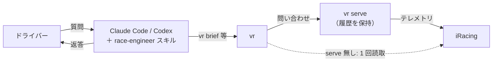

# vibe-racing

[](https://github.com/r4ai/vibe-racing/actions/workflows/ci.yml)
[](LICENSE)

走行中の無線の質問に、AI エージェントがレースエンジニアとして答える。
CLI `vr` がゲームのテレメトリを解析し、Claude Code / Codex 用スキルが答え方を決める。

```text
ドライバー: 前との差は？
エージェント: 前の Ito まで 0.6。毎周 0.4 詰めてる、次の周で射程内。
```

## 基本モデル

- **常駐コレクター**: `vr serve` が 60 Hz で読み続け、周回・燃費・ギャップ推移を蓄積
- **1 コマンド回答**: エージェントは原則 `vr brief` だけを実行
- **スキル**: 返答の長さ・丸め・推測禁止の規範
- **ゲーム非依存**: ゲーム固有の処理は入力アダプタに限定。対応は iRacing（Windows）



## 主な機能

### レース状況

- 順位（総合・クラス内）、前後とのギャップと推移
- コース上の近くの車（周回遅れ・他クラスを区別）
- 直近・ベスト・平均ラップ
- フラッグ、残り周回・時間、インシデント

### 燃料

- 1 周燃費と残り周回
- ゴールまでの不足量と給油量（余裕込み）
- 履歴が無い間は瞬間燃費から推定（推定と明示）

### 作戦

- 自車と他車のラップから、タイヤの落ち方とピットロスを実測
- 止まる周の案と次点、入った場合の復帰位置、給油で届く周の範囲
- 前後の車とのアンダーカット・オーバーカットの得失、応じる期限

### 車とセットアップ

- タイヤ、損傷、水温・油温、ピット作業、OTS・P2P、車内設定（BB・TC など）と変更履歴
- ガレージのセットアップ全項目
- アンダー・オーバー・空転・ロックの傾向と場所、走行中に変えられる項目の提案
- 走行後の分析（`vr sessions analyse`）: 車輪ごとのロック・空転、車高、タイヤの温度分布、ダンパー、ガレージの打ち手、変更の結果
- ゲームが出す全変数（`vr channels`）とセッション情報（`vr info`）

### 過去のセッション

- `vr serve` が自動で保存（結果、全車のラップ、イベント、セットアップ、挙動）
- ブラウザで閲覧（`vr serve` 中に <http://127.0.0.1:47800/>）
  - テレメトリ: 差・速度・アクセル・ブレーキ・ギア・舵を 2 つの周で重ねて表示
  - コースマップと、コーナーごとに失った時間とその理由
  - レース: タイム・順位・出来事・挙動を 1 つの時間軸に表示
  - セットアップ: 四輪の実測と打ち手、全項目、他のセッションとの差
- `vr sessions` で一覧・詳細・比較・メモ・書き出し・削除
- iRacing の `.ibt` を、走り終えた後に自動で取り込み

### イベント

- フラッグ、順位変動、ピットイン・アウト、インシデント、周回、自己ベスト
- 燃料不足、損傷、路面の変化、車内設定の変更、作戦の助言
- 差分取得（`vr events --since`）とストリーム（`vr watch`）

### 出力

- 簡潔なテキスト（既定）と JSON（`-f json`）
- データの出所と鮮度（`live`・`oneshot`、`age_ms`）
- 終了コード: ゲーム未接続 `3`、対象無し `4`

### 音声無線（`vr-radio`）

- 押している間だけ録音（画面のボタン、キーボード、ハンドルのボタン）
- 文字起こし → ACP でエージェントに質問 → 返答を文ごとに VOICEVOX で読み上げ
- 話すと読み上げを止め、言葉は必ずエージェントへ送信
- 出来事（イエロー・順位・損傷・燃料など）ごとに自分から連絡。種類ごとに切替
- 音量・話速・話者・自動連絡を、画面または走行中の無線で変更（「音量下げて」）
- 話しかけ方も言葉で変更（「ブレーキ中は話すな」「後ろが 1 秒切ったら教えて」「順位は言わなくていい」）
- 頼まれる前に裏で作戦を立て、変わったときと期限が近いときに提案
- 数字は無線の言い方で読み上げ（コンマ 1、1 分 55 秒ロクイチイチ）
- 起動すると `vr serve`・VOICEVOX・エージェントも自動で起動
- セットアップ・タイヤ・過去のレースなど、質問の話題に合うデータを先に渡して即答
- 時間がかかる調べ物は、先に「確認する、少し待って」と返答
- 認識・初回応答・初回音声までの時間を表示

### 記録と再生

- NDJSON 記録（`vr record`、`vr serve --record`）
- 記録・合成レースへの同じ問い合わせ（`--file`、`--game synthetic`）

## クイックスタート

ソースからビルド。

| ツール                   | バージョン          | 補足                         |
| ------------------------ | ------------------- | ---------------------------- |
| Rust                     | stable（1.88 以上） | [rustup](https://rustup.rs/) |
| iRacing                  | 現行版              | 実走時のみ。Windows 専用     |
| Claude Code または Codex | 現行版              |                              |
| VOICEVOX                 | 0.25 以上           | 音声無線のみ                 |

### インストール

```powershell
cargo install --path crates/vr-cli
```

```powershell
vr skill install
```

### ゲーム無しで試す

```powershell
vr serve --game synthetic --speed 10
```

```powershell
vr brief
```

### iRacing で使う

セッションに入り、走行中は `vr serve` を起動しておく（`vr-radio` を使うなら自動）。

```powershell
vr serve
```

あとはエージェントに「燃料あと何周？」などと聞く。
接続の確認は `vr doctor`。

### 声で聞く

[VOICEVOX](https://voicevox.hiroshiba.jp/) を導入し、[OpenRouter](https://openrouter.ai/) のキーを設定して起動する。
キーは作業ディレクトリの `.env`（`OPENROUTER_API_KEY=<key>`）でもよい。

```powershell
$env:OPENROUTER_API_KEY = "<key>"; cargo run --release -p vr-radio
```

- F9 を押している間に話す。別のキーやハンドルのボタンは、設定の「押して話す」で登録（どれを押しても同じ）
- 話者（試聴可）・エージェント（Claude Code / Codex）・文字起こしは設定で切り替え
- キー無しで使うなら、文字起こしを「Windows 標準」に（精度は低い）
- 常駐: 設定でトレイ常駐と Windows 起動時の開始を選択
- 画面無しの動作確認: `--ask "前との差は？"`
- 設定一覧: `vr-radio --help`

## 設定と連携

### スキルの配置先

| 対象        | 既定                             | `--project`                    |
| ----------- | -------------------------------- | ------------------------------ |
| Claude Code | `~/.claude/skills/race-engineer` | `.claude/skills/race-engineer` |
| Codex       | `~/.agents/skills/race-engineer` | `.agents/skills/race-engineer` |

片方だけなら `--target claude|codex`。
`vr` の更新後は `vr skill install` を再実行。

### サーバー

| 設定                     | 既定値                                   | 内容                           |
| ------------------------ | ---------------------------------------- | ------------------------------ |
| `vr serve --port`        | `47800`                                  | 待受ポート（`127.0.0.1` 限定） |
| `--server` / `VR_SERVER` | 自動検出                                 | 問い合わせ先 URL               |
| `VR_DISCOVERY`           | `%LOCALAPPDATA%\vibe-racing\server.json` | サーバー発見ファイル           |
| `VR_SESSIONS`            | `%LOCALAPPDATA%\vibe-racing\sessions`    | 過去のセッションの保存先       |

### コマンド

| コマンド                               | 内容                         |
| -------------------------------------- | ---------------------------- |
| `vr brief`                             | 無線回答用サマリ             |
| `vr gap [--car 23]`                    | 前後・指定車との差、近くの車 |
| `vr fuel`                              | 燃料と給油量                 |
| `vr strategy`                          | 作戦                         |
| `vr standings [--top N \| --around N]` | 順位表                       |
| `vr laps [--car N] [--last N]`         | ラップ履歴                   |
| `vr car` / `vr setup` / `vr handling`  | 車の状態・セットアップ・挙動 |
| `vr sessions list`                     | 過去のセッション             |
| `vr sessions analyse`                  | セットアップの分析           |
| `vr channels [語]` / `vr info [パス]`  | ゲームの全データ             |
| `vr events [--since SEQ]` / `vr watch` | イベント                     |
| `vr live [--hz N]`                     | 刻々と変わる値               |
| `vr record --out x.ndjson`             | 記録のみ                     |

詳細は [commands.md](skills/race-engineer/references/commands.md)。

## 構成とドキュメント

| 領域                                            | 内容                                      |
| ----------------------------------------------- | ----------------------------------------- |
| [`crates/`](crates)                             | Rust workspace（型・アダプタ・解析・CLI） |
| [`skills/race-engineer/`](skills/race-engineer) | スキルの正本（`vr` に埋め込み）           |
| [`docs/`](docs)                                 | 設計文書・開発ガイド                      |

| 文書                                                           | 内容                             |
| -------------------------------------------------------------- | -------------------------------- |
| [docs/architecture.md](docs/architecture.md)                   | 階層・依存・不変条件・処理フロー |
| [docs/development.md](docs/development.md)                     | ビルド・テスト・品質計測         |
| [skills/race-engineer/SKILL.md](skills/race-engineer/SKILL.md) | エージェントの手順と返答規範     |

## ライセンス

MIT
