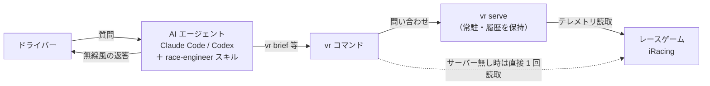

# vibe-racing

[](https://github.com/r4ai/vibe-racing/actions/workflows/ci.yml)
[](LICENSE)

走行中のドライバーが AI エージェントに「無線」で質問し、レースエンジニアとして答えてもらうためのツールである。
CLI `vr` がゲームのテレメトリを読み、順位・ギャップ・燃費・フラッグを解析する。
同梱の `race-engineer` スキルが、Claude Code や Codex に `vr` の使い方と無線向けの返答規範を教える。
対応ゲームは iRacing（Windows）で、ゲーム無しで試せる合成レースと記録再生も備える。

```text
ドライバー: 前との差は？
エージェント: （vr brief を実行）
              前の Ito まで 0.6。毎周 0.4 詰めてる、次の周で射程内。
```

## 基本モデル

- **常駐コレクター**: `vr serve` がゲームを 60 Hz で読み、周回記録・平均燃費・ギャップ推移を蓄積
- **1 コマンド回答**: `vr brief` が無線で要る情報を 1 回で返却。エージェントは原則これだけを実行
- **スキルによる振る舞い**: 返答の長さ・丸め・推測禁止などの規範をスキルとして配布
- **ゲーム非依存の中核**: ゲームごとの差は入力アダプタに限定。解析と出力は全ゲーム共通



## 主な機能

### レース状況の把握

- 順位（総合・クラス内）、前後の車とのギャップと毎周の詰まり方
- コース上で物理的に近い車（周回遅れ・他クラスの区別付き）
- 直近・ベスト・クリーンラップ平均のラップタイム
- フラッグ、残り周回・残り時間、インシデント数

### 燃料計算

- クリーンラップから求めた 1 周燃費と、燃料が持つ周回数
- ゴールまでの不足量と、余裕込みの給油量
- 履歴が無いときは瞬間燃費からの推定（推定である旨を明示）

### イベント

- フラッグの変化、順位変動、ピットイン・アウト（自車と近傍車）、インシデント、周回、自己ベスト
- 連番による差分取得（`vr events --since`）とストリーム（`vr watch`）

### 出力

- 既定はエージェントが読みやすい簡潔なテキスト。`-f json` で機械可読な JSON
- データの出所と鮮度（`live`・`oneshot` など、`age_ms`）を問い合わせ結果に付与
- 終了コードで「ゲーム未接続」（3）と「対象が無い」（4）を区別

### 記録と再生

- 正規化したテレメトリの NDJSON 記録（`vr record`、`vr serve --record`）
- 記録や合成レースに対する同じコマンドの実行（`--file`、`--game synthetic`）

## クイックスタート

リリースバイナリは無い。ソースからビルドする。

| ツール                   | バージョン          | 補足                                |
| ------------------------ | ------------------- | ----------------------------------- |
| Rust                     | stable（1.88 以上） | [rustup](https://rustup.rs/) で導入 |
| iRacing                  | 現行版              | 実走時のみ。Windows 専用            |
| Claude Code または Codex | 現行版              | スキルを使う場合                    |

### インストール

```powershell
cargo install --path crates/vr-cli
```

```powershell
vr skill install
```

`vr skill install` はスキルを Claude Code と Codex の両方のユーザーディレクトリへコピーする。

### ゲーム無しで試す

合成レースを 10 倍速で流す。

```powershell
vr serve --game synthetic --speed 10
```

別のターミナルで状況を見る。

```powershell
vr brief
```

### iRacing で使う

iRacing でセッションに入り、走行中は `vr serve` を起動したままにする。

```powershell
vr serve
```

Claude Code または Codex に「燃料あと何周？」のように話しかける。
エージェントがスキルに従って `vr brief` などを実行し、短く答える。

接続の状態は `vr doctor` で確認できる。

```powershell
vr doctor
```

## 設定と連携

### スキルの配置先

| 対象        | ユーザー単位（既定）             | プロジェクト単位（`--project`） |
| ----------- | -------------------------------- | ------------------------------- |
| Claude Code | `~/.claude/skills/race-engineer` | `.claude/skills/race-engineer`  |
| Codex       | `~/.agents/skills/race-engineer` | `.agents/skills/race-engineer`  |

片方だけに入れる場合は `--target claude` または `--target codex` を付ける。
`vr` を更新したら `vr skill install` を再実行してスキルも更新する。

### サーバーの指定

| 設定                     | 既定値                                   | 内容                           |
| ------------------------ | ---------------------------------------- | ------------------------------ |
| `vr serve --port`        | `47800`                                  | 待受ポート（`127.0.0.1` 限定） |
| `--server` / `VR_SERVER` | 自動検出                                 | 問い合わせ先の URL             |
| `VR_DISCOVERY`           | `%LOCALAPPDATA%\vibe-racing\server.json` | サーバー発見ファイルの場所     |

複数の `vr serve` を並べる場合は、ポートと `VR_DISCOVERY` をそれぞれ分ける。

### 主なコマンド

| コマンド                               | 内容                         |
| -------------------------------------- | ---------------------------- |
| `vr brief`                             | 無線回答用サマリ             |
| `vr gap [--car 23]`                    | 前後・指定車との差、近くの車 |
| `vr fuel`                              | 燃料と給油量                 |
| `vr standings [--top N \| --around N]` | 順位表                       |
| `vr laps [--car N] [--last N]`         | ラップ履歴                   |
| `vr events [--since SEQ]` / `vr watch` | イベントの取得・ストリーム   |
| `vr record --out x.ndjson`             | 記録のみ                     |

全オプション・JSON フィールド・HTTP API は [commands.md](skills/race-engineer/references/commands.md) を参照する。

## 構成とドキュメント

| 領域                                            | 内容                                                        |
| ----------------------------------------------- | ----------------------------------------------------------- |
| [`crates/`](crates)                             | Rust workspace。共通型・ゲームアダプタ・解析・サーバー・CLI |
| [`skills/race-engineer/`](skills/race-engineer) | エージェント用スキルの正本（`vr` に埋め込み）               |
| [`docs/`](docs)                                 | 設計文書と開発ガイド                                        |

| 文書                                                                                       | 内容                                                           |
| ------------------------------------------------------------------------------------------ | -------------------------------------------------------------- |
| [docs/architecture.md](docs/architecture.md)                                               | 階層・実行時構成・依存関係・不変条件・処理フロー・拡張方式     |
| [docs/development.md](docs/development.md)                                                 | ビルド・テスト・カバレッジ・ミューテーションテスト・記録データ |
| [skills/race-engineer/SKILL.md](skills/race-engineer/SKILL.md)                             | エージェントの手順と返答規範                                   |
| [skills/race-engineer/references/commands.md](skills/race-engineer/references/commands.md) | コマンドと API の仕様                                          |

## ライセンス

MIT
