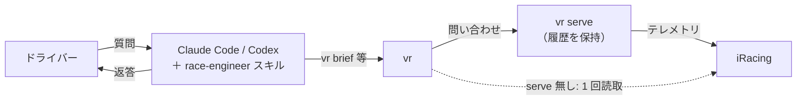

# vibe-racing

[](https://github.com/r4ai/vibe-racing/actions/workflows/ci.yml)
[](LICENSE)

走行中の無線の質問に、AI エージェントがレースエンジニアとして答える。
CLI `vr` がゲームのテレメトリを解析し、Claude Code / Codex 用スキルが答え方を決める。

```text
ドライバー: 前との差は？
エージェント: 前の Ito まで 0.6。毎周 0.4 詰めてる、次の周で射程内。
```

## 基本モデル

- **常駐コレクター**: `vr serve` が 60 Hz で読み続け、周回・燃費・ギャップ推移を蓄積
- **1 コマンド回答**: エージェントは原則 `vr brief` だけを実行
- **スキル**: 返答の長さ・丸め・推測禁止の規範
- **ゲーム非依存**: ゲーム固有の処理は入力アダプタに限定。対応は iRacing（Windows）



## 主な機能

### レース状況

- 順位（総合・クラス内）、前後とのギャップと推移
- コース上の近くの車（周回遅れ・他クラスを区別）
- 直近・ベスト・平均ラップ
- フラッグ、残り周回・時間、インシデント

### 燃料

- 1 周燃費と残り周回
- ゴールまでの不足量と給油量（余裕込み）
- 履歴が無い間は瞬間燃費から推定（推定と明示）

### イベント

- フラッグ、順位変動、ピットイン・アウト、インシデント、周回、自己ベスト
- 差分取得（`vr events --since`）とストリーム（`vr watch`）

### 出力

- 簡潔なテキスト（既定）と JSON（`-f json`）
- データの出所と鮮度（`live`・`oneshot`、`age_ms`）
- 終了コード: ゲーム未接続 `3`、対象無し `4`

### 記録と再生

- NDJSON 記録（`vr record`、`vr serve --record`）
- 記録・合成レースへの同じ問い合わせ（`--file`、`--game synthetic`）

## クイックスタート

ソースからビルド。

| ツール                   | バージョン          | 補足                         |
| ------------------------ | ------------------- | ---------------------------- |
| Rust                     | stable（1.88 以上） | [rustup](https://rustup.rs/) |
| iRacing                  | 現行版              | 実走時のみ。Windows 専用     |
| Claude Code または Codex | 現行版              |                              |

### インストール

```powershell
cargo install --path crates/vr-cli
```

```powershell
vr skill install
```

### ゲーム無しで試す

```powershell
vr serve --game synthetic --speed 10
```

```powershell
vr brief
```

### iRacing で使う

セッションに入り、走行中は `vr serve` を起動しておく。

```powershell
vr serve
```

あとはエージェントに「燃料あと何周？」などと聞く。
接続の確認は `vr doctor`。

## 設定と連携

### スキルの配置先

| 対象        | 既定                             | `--project`                    |
| ----------- | -------------------------------- | ------------------------------ |
| Claude Code | `~/.claude/skills/race-engineer` | `.claude/skills/race-engineer` |
| Codex       | `~/.agents/skills/race-engineer` | `.agents/skills/race-engineer` |

片方だけなら `--target claude|codex`。
`vr` の更新後は `vr skill install` を再実行。

### サーバー

| 設定                     | 既定値                                   | 内容                           |
| ------------------------ | ---------------------------------------- | ------------------------------ |
| `vr serve --port`        | `47800`                                  | 待受ポート（`127.0.0.1` 限定） |
| `--server` / `VR_SERVER` | 自動検出                                 | 問い合わせ先 URL               |
| `VR_DISCOVERY`           | `%LOCALAPPDATA%\vibe-racing\server.json` | サーバー発見ファイル           |

### コマンド

| コマンド                               | 内容                         |
| -------------------------------------- | ---------------------------- |
| `vr brief`                             | 無線回答用サマリ             |
| `vr gap [--car 23]`                    | 前後・指定車との差、近くの車 |
| `vr fuel`                              | 燃料と給油量                 |
| `vr standings [--top N \| --around N]` | 順位表                       |
| `vr laps [--car N] [--last N]`         | ラップ履歴                   |
| `vr events [--since SEQ]` / `vr watch` | イベント                     |
| `vr record --out x.ndjson`             | 記録のみ                     |

詳細は [commands.md](skills/race-engineer/references/commands.md)。

## 構成とドキュメント

| 領域                                            | 内容                                      |
| ----------------------------------------------- | ----------------------------------------- |
| [`crates/`](crates)                             | Rust workspace（型・アダプタ・解析・CLI） |
| [`skills/race-engineer/`](skills/race-engineer) | スキルの正本（`vr` に埋め込み）           |
| [`docs/`](docs)                                 | 設計文書・開発ガイド                      |

| 文書                                                           | 内容                             |
| -------------------------------------------------------------- | -------------------------------- |
| [docs/architecture.md](docs/architecture.md)                   | 階層・依存・不変条件・処理フロー |
| [docs/development.md](docs/development.md)                     | ビルド・テスト・品質計測         |
| [skills/race-engineer/SKILL.md](skills/race-engineer/SKILL.md) | エージェントの手順と返答規範     |

## ライセンス

MIT
