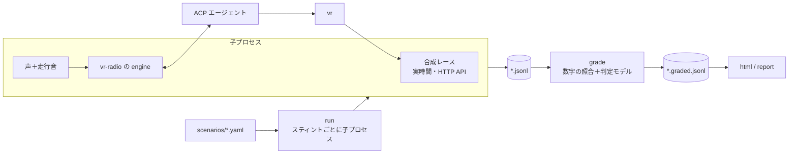

# vr-eval アーキテクチャ

## 概要と基本概念

音声無線 `vr-radio` を端から端まで動かし、答えが伝わるまでの時間と正確さを測る評価ツール。
模擬するのはレース・ドライバーの声・マイク・スピーカーだけで、文字起こし・エージェント・`vr`・VOICEVOX は本物を使う。

### 用語

| 用語       | 定義                                                                     |
| ---------- | ------------------------------------------------------------------------ |
| スティント | 1 つのレースと 1 つのエージェントセッション。複数の呼びかけを順に行う    |
| 呼びかけ   | ドライバーの 1 回の無線。期待する事実（`facts`）と観点（`points`）を持つ |
| 構成       | 評価対象の `vr-radio` の引数一式                                         |
| 伝達時間   | 最後の言葉の終わりから、最初の `facts` を含む文が鳴り終わるまで          |
| 判定割れ   | 判定モデル同士、または判定と数字の照合が食い違った結果。良いには数えない |

## 実行時の構成



## コードマップ

| パス                                      | 責務                                                     |
| ----------------------------------------- | -------------------------------------------------------- |
| [`scenarios/`](../scenarios)              | 問題集（`dev` は改善用、`heldout` は確認専用）           |
| [`src/scenario.rs`](../src/scenario.rs)   | 問題集の形式と検査                                       |
| [`src/world.rs`](../src/world.rs)         | レースの早送りと実時間進行、真実の記録                   |
| [`src/audio.rs`](../src/audio.rs)         | 声の合成と保存、走行音・切れ・無音                       |
| [`src/run.rs`](../src/run.rs)             | マイクとスピーカーの模擬、1 回の呼びかけの記録           |
| [`src/facts.rs`](../src/facts.rs)         | 真実の値、回答中の数字の読み取りと照合                   |
| [`src/judge.rs`](../src/judge.rs)         | 判定モデルへの質問と評点                                 |
| [`src/calibrate.rs`](../src/calibrate.rs) | 正解が分かっている回答（判定モデルと照合の精度測定）     |
| [`src/report.rs`](../src/report.rs)       | 集計、対応のある差と区間                                 |
| [`src/html.rs`](../src/html.rs)           | HTML レポート（[`src/report.html`](../src/report.html)） |

## 設計上の不変条件

- **盲検**: 判定モデルには構成名・エージェント名を見せない。調べる側（Anthropic・OpenAI）と別会社のモデルを使う
- **真実は計算**: 期待値を手で書かない。質問の終わりの 3 秒前から最後の文の鳴り始めまでに実在した値を正しいとする
- **dev で改善、heldout で確認**: heldout の回答を見てプロンプト・語彙・閾値を変えない。言い回しと声の重複はテストが検査
- **評価の修正は全構成に**: 採点方法を変えたら、比較する構成をすべて採点し直す
- **エージェントに鍵を渡さない**: `OPENROUTER_API_KEY` は子プロセスの環境から消す
- **計測中はビルドしない**: VOICEVOX が CPU を使うため、遅延が変わる

## 使い方

前提は VOICEVOX engine、ログイン済みのエージェント、`OPENROUTER_API_KEY`（環境変数か `.env`）。

```bash
cargo build --release -p vr-cli -p vr-eval
```

```bash
target/release/vr-eval calibrate
```

`--` の後ろが `vr-radio` の引数。時間帯の影響を打ち消すため、構成を交互に 1 試行ずつ `--append` で足す。

```bash
target/release/vr-eval run --name v2 --label "改善版" --append --no-grade --vr target/release/vr -- --agent "npx -y @agentclientprotocol/codex-acp@2.6.0"
```

```bash
target/release/vr-eval grade v2
```

```bash
target/release/vr-eval report base v2 --problems
```

```bash
target/release/vr-eval html base v2 --out target/eval/report.html
```

`html` は各セットの最初の構成を基準とし、外部通信は Web フォントだけの 1 ファイルを出力する。

## 限界

- 声は合成音声で、ドライバー本人の声・実際のマイクではない
- 走行音は倍音と風の合成で、実録ではない
- レースは合成データで、iRacing の実データではない
- 判定モデルの精度は、機械的に作った 63 例での値
