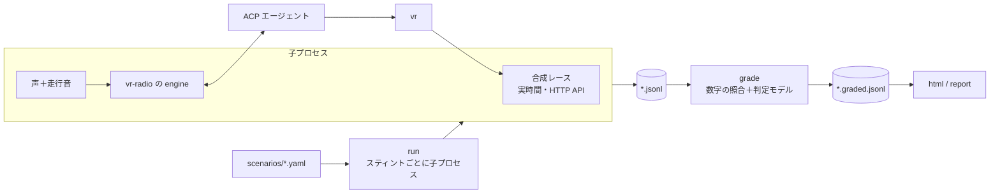

# vr-eval アーキテクチャ

## 概要と基本概念

音声無線 `vr-radio` を端から端まで動かし、答えが伝わるまでの時間と正確さを測る評価ツール。
模擬するのはレース・ドライバーの声・マイク・スピーカーだけで、文字起こし・エージェント・`vr`・VOICEVOX は本物を使う。

### 用語

| 用語       | 定義                                                                                        |
| ---------- | ------------------------------------------------------------------------------------------- |
| スティント | 1 つのレースと 1 つのエージェントセッション。複数の呼びかけを順に行う                       |
| 呼びかけ   | ドライバーの 1 回の無線。期待する事実（`facts`）と観点（`points`）を持つ                    |
| 構成       | 評価対象の `vr-radio` の引数一式                                                            |
| 伝達時間   | 最後の言葉の終わりから、最初の `facts` を含む文が鳴り終わるまで                             |
| 聞き役     | ドライバーが黙っている呼びかけ。エンジニアの自発的な連絡（`call`）か、沈黙（`quiet`）を待つ |
| 判定割れ   | 判定モデル同士、または判定と数字の照合が食い違った結果。良いには数えない                    |

## 実行時の構成



## コードマップ

| パス                                      | 責務                                                     |
| ----------------------------------------- | -------------------------------------------------------- |
| [`scenarios/`](../scenarios)              | 問題集（下表）                                           |
| [`src/scenario.rs`](../src/scenario.rs)   | 問題集の形式と検査                                       |
| [`src/world.rs`](../src/world.rs)         | レースの早送りと実時間進行、真実の記録                   |
| [`src/audio.rs`](../src/audio.rs)         | 声の合成と保存、走行音・切れ・無音                       |
| [`src/run.rs`](../src/run.rs)             | マイクとスピーカーの模擬、1 回の呼びかけの記録           |
| [`src/facts.rs`](../src/facts.rs)         | 真実の値、回答中の数字の読み取りと照合                   |
| [`src/judge.rs`](../src/judge.rs)         | 判定モデル（Codex CLI・OpenRouter）への質問と評点        |
| [`src/calibrate.rs`](../src/calibrate.rs) | 正解が分かっている回答（判定モデルと照合の精度測定）     |
| [`src/setting.rs`](../src/setting.rs)     | ラジオの設定が頼まれたとおりに変わったかの照合           |
| [`src/topics.rs`](../src/topics.rs)       | 質問の話題の見分け（語と判定モデル）の測定               |
| [`src/report.rs`](../src/report.rs)       | 集計、対応のある差と区間                                 |
| [`src/html.rs`](../src/html.rs)           | HTML レポート（[`src/report.html`](../src/report.html)） |

## 問題集

| ファイル                | 内容                                                                         | 用途   |
| ----------------------- | ---------------------------------------------------------------------------- | ------ |
| `dev.yaml`              | レース中の基本の質問                                                         | 改善用 |
| `heldout.yaml`          | 同上                                                                         | 確認用 |
| `hard.yaml`             | 動揺、聞き取れない無線、現実的なレース                                       | 改善用 |
| `features.yaml`         | 車の状態、挙動とセットアップ、過去のレース、設定の変更、自発的な連絡、調べ物 | 改善用 |
| `features-heldout.yaml` | 同上                                                                         | 確認用 |
| `rules.yaml`            | 黙る条件・見張り・続く指示・連絡の頻度                                       | 改善用 |
| `strategy.yaml`         | ピットの時期、損失、アンダーカット、落ち方、自発的な作戦の連絡               | 改善用 |
| `topics.yaml`           | 話題のラベルだけ（69 問）                                                    | 改善用 |
| `topics-heldout.yaml`   | 同上（35 問）                                                                | 確認用 |
| `complex.yaml`          | 決まった形に無い質問: 一度に複数、もしも、全体・過去の集計、続きの質問       | 改善用 |
| `complex-heldout.yaml`  | 同上                                                                         | 確認用 |
| `pressure.yaml`         | 極限での無線: 叫びへの具体策、ピットかステイアウトか、他車と攻めどころ       | 改善用 |

## 機械的な検査

判定モデルの評価とは別に、次を値で確かめる。

- **数字**: `facts` の値が、その時間帯に実在した範囲にあるか
- **設定**: `settings`（`volume<100`、`event.position=off`、条件式は `hold~brake` のように含まれる語）のとおりに変わったか。頼まれていない変更は、どの呼びかけでも誤り
- **待たせ方**: 返答の開始が 5 秒を超えた回答のうち、先に「確認する」と伝えた数（表の `announced`）

## 設計上の不変条件

- **盲検**: 判定モデルには構成名・エージェント名を見せない
- **判定役の会社**: 既定は Codex CLI の 2 モデル（ChatGPT の利用枠で動き、従量課金が無い）。Codex を評価するときは同じ会社のモデルが採点するため、報告にその旨を書く
- **真実は計算**: 期待値を手で書かない。質問の終わりの 3 秒前から最後の文の鳴り始めまでに実在した値を正しいとする
- **dev で改善、heldout で確認**: heldout の回答を見てプロンプト・語彙・閾値を変えない。言い回しと声の重複はテストが検査
- **評価の修正は全構成に**: 採点方法を変えたら、比較する構成をすべて採点し直す
- **エージェントに鍵を渡さない**: `OPENROUTER_API_KEY` は子プロセスの環境から消す
- **利用者の記録に触れない**: 過去のセッションはスティントごとの空の場所（`VR_SESSIONS`）に作る
- **計測中はビルドしない**: VOICEVOX が CPU を使うため、遅延が変わる

## 使い方

前提は VOICEVOX engine、ログイン済みのエージェントと Codex CLI（判定役）。
`OPENROUTER_API_KEY`（環境変数か `.env`）は、声の合成・文字起こし・OpenRouter の判定役に使う。

```bash
cargo build --release -p vr-cli -p vr-eval
```

```bash
target/release/vr-eval calibrate
```

`--` の後ろが `vr-radio` の引数。時間帯の影響を打ち消すため、構成を交互に 1 試行ずつ `--append` で足す。

```bash
target/release/vr-eval run --name v2 --label "改善版" --append --no-grade --vr target/release/vr -- --agent "npx -y @agentclientprotocol/codex-acp@2.6.0"
```

`--text` は声も文字起こしも使わず、質問文をそのまま入力する（`OPENROUTER_API_KEY` が不要）。
時間の起点は送信した瞬間で、文字起こしが一瞬で終わった場合の下限を測る。
言葉の無い呼びかけ（雑音だけ）は飛ばし、雑音・切れ・言い直しの聞き取りは検査しない。

```bash
target/release/vr-eval grade v2
```

判定役は `--judge` で変える（`codex:<model>[@<思考量>]`、または OpenRouter のモデル名）。

```bash
target/release/vr-eval report base v2 --problems
```

```bash
target/release/vr-eval html base v2 --out target/eval/report.html
```

`html` は各セットの最初の構成を基準とし、外部通信は Web フォントだけの 1 ファイルを出力する。

質問の話題の見分けだけを測る（エージェントも VOICEVOX も不要）。

```bash
target/release/vr-eval topics --problems
```

`--model` で判定モデルを変え、`--no-words` で語を使わずに全問を聞く。

保存した実セッションへの質問は、正解を SQL で毎回求め、答えの数字と名前を採点者なしで確かめる（[`gold`](../src/gold.rs)、問題は [`scenarios/gold.yaml`](../scenarios/gold.yaml)）。

```bash
target/release/vr-eval gold                                   # 正解を表示
target/release/vr-eval gold --answers run.jsonl               # 答え（q と a の JSON 行）を確かめる
target/release/vr-eval gold --harvest %LOCALAPPDATA%r-radio
adio.jsonl  # 無線で聞かれたがまだ問題にない質問
```

`vr-radio` は質問と返答を 1 行ずつ `radio.jsonl` に残す（`--transcript`、空で残さない）。実際に聞かれた質問を `--harvest` で拾い、SQL を書いて問題に足していく。

## 限界

- 声は合成音声で、ドライバー本人の声・実際のマイクではない
- 走行音は倍音と風の合成で、実録ではない
- レースは合成データで、iRacing の実データではない
- 判定モデルの精度は、機械的に作った 87 例での値（3 回の多数決で 84/86、良いと誤判定した例は無し。その後 2 例を修正）
- 挙動（アンダー・空転など）は、どのコーナーも同じ合成の操作と車の動き
- 自発的な連絡は、出来事の時刻が決まったスティントだけで試す
- 文字入力（`--text`）は聞き取りを経ないため、伝達時間は音声のときより短く、雑音・切れの影響を含まない
