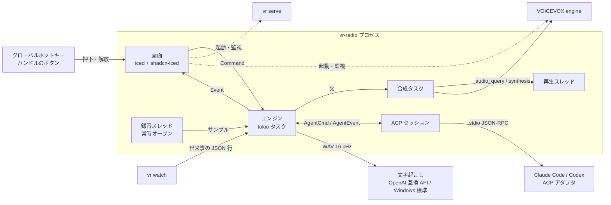
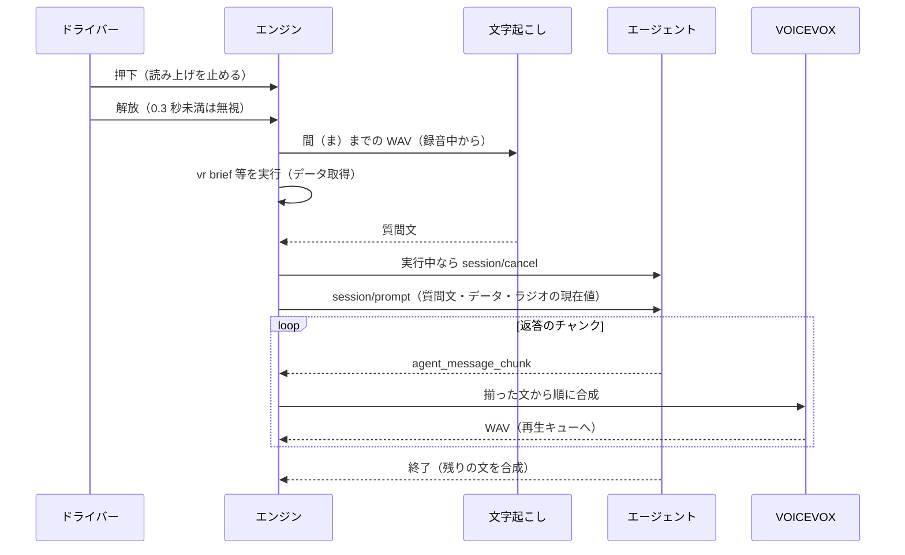

# vr-radio アーキテクチャ

## 概要と基本概念

押している間だけ録音し、文字起こしした質問を ACP でエージェントに送り、返答を文単位で VOICEVOX が読み上げる GUI アプリ。
テレメトリには触れず、`vr` の実行はエージェントに任せる。
レース中の出来事は `vr watch` から受け取り、エンジニアの側から連絡する。

### 設計目標

- **初回音声までの短さ**: 返答の最初の句が揃った時点で合成を開始
- **待たせない準備**: 規則とスキルは接続時に読ませ、データは文字起こしと同時に取得して質問に添付
- **話している間の文字起こし**: 間（ま）で区切り、ボタンを離す前に開始
- **常駐セッション**: エージェントのプロセスと ACP セッションを起動時に 1 回だけ作成
- **割り込み**: 話し始めると読み上げを止め、言葉が取れたらエージェントを中断して送る。言葉は失わない
- **手を離さない操作**: 音量・話速・話者・自動連絡は無線で変えられる
- **自動連絡**: 黄旗・インシデントなどを、聞かれる前に 1 文で伝える
- **起動は 1 つだけ**: `vr serve`・VOICEVOX・エージェントを自分で起動し、落ちたら起動し直す
- **ハードウェア無しで検証可能**: 録音・文字起こし・合成・再生・エージェントは trait で差し替え

### 用語

| 用語     | 定義                                                         |
| -------- | ------------------------------------------------------------ |
| ターン   | 1 回の質問と返答。番号で識別し、古いターンのイベントは捨てる |
| 世代     | 割り込みのたびに増える番号。古い世代の文は合成・再生しない   |
| 連絡     | 出来事をきっかけにエンジニアから始めるターン                 |
| 設定指示 | 返答に書かれた `[[radio キー=値]]`。表示も読み上げもしない   |
| 文の区切 | `。！？!?…` と改行、`. `。40 文字を超えたら `、` でも区切る  |
| 許可方針 | エージェントの権限要求への自動応答（`safe`・`all`・`none`）  |

## 実行時の構成

| 実行単位       | 技術形態           | 役割                                      |
| -------------- | ------------------ | ----------------------------------------- |
| 画面           | iced（主スレッド） | 会話・ツール実行・遅延の表示、設定        |
| エンジン       | tokio タスク       | ターン管理、文分割、割り込み              |
| 録音スレッド   | `std::thread`      | 既定マイクを開いたまま、押下中だけ蓄積    |
| 再生スレッド   | `std::thread`      | 既定出力の再生キュー                      |
| ACP セッション | tokio タスク       | 子プロセスのエージェントとの 1 セッション |

マイクと出力を開けない場合も起動し、5 秒ごとに開き直す。その間は文字入力の質問だけ使える。

### 起動するもの

| 対象         | 条件                                            | 失敗・終了時                                        |
| ------------ | ----------------------------------------------- | --------------------------------------------------- |
| `vr serve`   | 窓の起動時（`--serve`、空なら無し）             | 15 秒ごとに再実行（`--if-needed` で重複しない）     |
| `vr watch`   | 同上（`--watch`、空なら自動連絡無し）           | 1 秒から 30 秒まで間隔を延ばして再実行              |
| VOICEVOX     | ローカルの URL が応答しないとき（`--voicevox`） | 15 秒から 5 分まで間隔を延ばして再実行              |
| エージェント | 常に                                            | 2・5・15・30 秒後に再接続。認証エラーは再接続しない |

- 自分で起動したものだけを終了時に止める
- VOICEVOX の話者一覧は 2 秒ごとに取り直し、60 秒で初めてエラーを出す（以後 10 秒ごと）
- `--ask` では何も起動しない
- 状態は左下の一覧（エージェント・音声・テレメトリ・マイク）に出す。テレメトリは `vr watch` が動き続けていることだけを示し、ゲームの接続は示さない

## コードマップ

| パス                                      | 責務                                           |
| ----------------------------------------- | ---------------------------------------------- |
| [`src/engine.rs`](../src/engine.rs)       | パイプライン、ターン・世代、遅延計測           |
| [`src/agent.rs`](../src/agent.rs)         | ACP クライアント、実行中ターンの取消と次の送信 |
| [`src/policy.rs`](../src/policy.rs)       | 権限要求の自動応答                             |
| [`src/text.rs`](../src/text.rs)           | 文分割、Markdown 除去                          |
| [`src/stt.rs`](../src/stt.rs)             | 文字起こし API、キーの選択、任意の LLM 校正    |
| [`src/early.rs`](../src/early.rs)         | 録音中の文字起こし（区切りと推測）             |
| [`src/vad.rs`](../src/vad.rs)             | 録音中の間（ま）の検出                         |
| [`src/context.rs`](../src/context.rs)     | 質問に添付するデータの取得（`vr brief` 等）    |
| [`src/directive.rs`](../src/directive.rs) | 返答の中の設定指示の抽出                       |
| [`src/watch.rs`](../src/watch.rs)         | 出来事の受信、連絡の種類・間隔                 |
| [`src/child.rs`](../src/child.rs)         | 補助プロセスの起動と監視                       |
| [`src/sapi.rs`](../src/sapi.rs)           | Windows 標準の文字起こし（常駐 PowerShell）    |
| [`src/voicevox.rs`](../src/voicevox.rs)   | 話者一覧、音声合成                             |
| [`src/audio.rs`](../src/audio.rs)         | マイク（cpal）・スピーカー（rodio）            |
| [`src/wav.rs`](../src/wav.rs)             | ダウンミックス、リサンプル、WAV 符号化         |
| [`src/app.rs`](../src/app.rs)             | 画面の状態、デバイスとエンジンの結線           |
| [`src/app/view.rs`](../src/app/view.rs)   | 画面のレイアウト                               |
| [`src/fonts.rs`](../src/fonts.rs)         | 同梱フォント（`assets/fonts/`）                |
| [`src/chrome.rs`](../src/chrome.rs)       | ウィンドウ枠（Windows のヒットテスト）         |
| [`src/config.rs`](../src/config.rs)       | 引数・環境変数、Windows の `npx.cmd` 解決      |
| [`src/settings.rs`](../src/settings.rs)   | 設定画面の選択の保存                           |
| [`src/hotkey.rs`](../src/hotkey.rs)       | グローバルキーの登録と割り当て                 |
| [`src/wheel.rs`](../src/wheel.rs)         | ハンドルのボタン（Raw Input）                  |
| [`src/resident.rs`](../src/resident.rs)   | トレイ、自動起動、二重起動の防止               |

## 設計上の不変条件

- **テレメトリ非依存**: workspace の他 crate に依存しない（`crates/vr-cli/tests/architecture.rs`）。データは外部コマンド（`--context`）の出力としてだけ扱う
- **1 セッション 1 ターン**: 新しい質問は実行中のターンを `session/cancel` してから送る
- **言葉を失わない**: 聞き取り中に次を話しても、前の言葉もエージェントに送る（返答は最後の質問の分だけ読み上げる）。送信待ちの言葉は 1 通にまとめる。「止める」だけは捨てる
- **言葉の無い押下は無害**: 短い押下と無音は読み上げを止めるだけで、押している間の文は離した後に読む
- **設定を変えるのはドライバー**: 設定指示は質問のターンでだけ適用し、連絡のターンでは捨てる
- **古いイベントの破棄**: 現在のターン以外のチャンク・ツール通知は表示も読み上げもしない
- **キーは持ち主のサービスだけに送る**: OpenRouter には `OPENROUTER_API_KEY`、他には `OPENAI_API_KEY`。設定ファイルには保存しない
- **終わらないターンを作らない**: 文字起こしの失敗やエージェント未接続は、そのターンを失敗で終える
- **運転中に確認を出さない**: 権限要求は許可方針で即答。`safe` は読取・検索・取得と、問い合わせの `vr` コマンドだけ許可（`serve`・`record`・`skill`・`sessions delete` は拒否）し、`&` `|` `;` 等で連結したコマンドは拒否
  - Codex は自分の審査で権限を昇格させることがあり、その実行はこの方針を通らない

## 主要な処理フロー

応答の速さと正確さは [vr-eval](../../vr-eval/docs/architecture.md) で測る。

画面には各ターンの「認識」「初回応答」「初回音声」「完了」までの時間を表示。
起点は録音の終了（文字入力では送信）。

## 横断的設計トピック

### 文字起こし

OpenAI 互換の `/audio/transcriptions` を使い、OpenRouter（既定）・OpenAI・Groq・ローカルの whisper サーバーを URL で切り替える。
既定のモデルは `openai/gpt-transcribe`。
2026-11-22 に OpenRouter で比較した結果（VOICEVOX 2 話者 × 4 文、語彙ヒント付き、逐次実行。合成音声だけの小さな比較）。

| モデル                          | 中央値 | 主な誤り                                     |
| ------------------------------- | ------ | -------------------------------------------- |
| `openai/gpt-transcribe`         | 0.74 s | 「はいつ」→「開通」1 件                      |
| `openai/gpt-4o-mini-transcribe` | 1.07 s | 「はいつ」→「あいつ」1 件、「周」→「週」2 件 |
| `assemblyai/universal-3-6-pro`  | 0.44 s | 「周」→「週」「州」、語中の空白              |
| `elevenlabs/scribe-v2`          | 0.98 s | 「はいつ」→「アイツー」、「周」→「週」2 件   |
| `microsoft/mai-transcribe-2`    | 0.82 s | 「イエロー」を `イ**ー` と伏せ字にする       |
| `qwen/qwen3-asr-0.6b`           | 1.03 s | 「周」→「週」4 件、「もつ」→「通」2 件       |
| `qwen/qwen3-asr-1.7b`           | 21 s   | 0.7〜34 s とばらつき、「周」→「週」「州」    |

Windows 標準は SAPI（`System.Speech`）で、API キーも通信も要らないが、レース用語の精度は低い。
Windows PowerShell を常駐させ、WAV を 1 行の base64 で渡す。
Windows AI API の `Microsoft.Windows.AI.Speech` は実験版で、対応言語の記載も無いため使わない。

`--refine-model` を指定すると `/chat/completions` でレース用語を校正する（1 往復増える）。

### エージェント

`--agent` は ACP アダプタの起動コマンド。設定から切り替えると、古いセッションのタスクを打ち切ってプロセスを終わらせ、新しいセッションを開く。既定は公開から 7 日以上経った版に固定した `@agentclientprotocol/claude-agent-acp`。
エージェントが `vr` を `cargo run` で起動するとビルド待ちで遅いため、`cargo install --path crates/vr-cli` で PATH に置く。

接続直後の規則の読み込み中に質問が来たら、読み込みを取り消し、規則と質問を 1 通で送る。

### 自動連絡

- 1.5 秒以内の出来事は 1 回にまとめ、10 秒を過ぎたものは捨てる
- 録音・質問・読み上げの間は待つ。急がない連絡は 8 秒以上空ける
- 急ぐもの（黄旗・赤旗・黒旗など、インシデント、損傷、燃料不足）は間隔を待たない
- 伝えるかどうかはエージェントが決める。`-` だけの返答は表示も読み上げもしない
- 種類ごとに切り替える。既定はラップと車内調整だけオフ。旗の解除は黄旗とコーションだけ

### 設定指示

`[[radio volume=60]]` の形で、1 つに複数書ける。チャンクの途中で切れていても抽出し、読めないものはエラーとして表示する。

| キー           | 値                                                  |
| -------------- | --------------------------------------------------- |
| `volume`       | 0〜150（%）。`+20`・`-20` は相対                    |
| `speed`        | 0.5〜2.0。`+0.1`・`-0.1` は相対                     |
| `mute`         | `on`・`off`                                         |
| `speaker`      | キャラクター名・スタイル名・両方                    |
| `proactive`    | `on`・`off`                                         |
| `event.<種類>` | `on`・`off`。種類は出来事の `type` かまとまりの名前 |

ミュートは保存しない。ほかは設定画面と同じく保存する。

### 設定の保存

設定画面の選択は `settings.json`（Windows は `%APPDATA%\vr-radio\`、`--settings` で変更）に保存。
優先順は、引数・環境変数、設定ファイル、既定値。
壊れた設定ファイルは無視し、上書きもしない。

### 押して話す操作

- グローバルキー: 文字キーは修飾キーとの組み合わせだけ割り当て可（他のアプリの入力を奪うため）
- ハンドル: Raw Input を `RIDEV_INPUTSINK` で受け、ゲームが前面でもボタン数の制限無しに検出
  - ハードウェア ID（VID・PID・インターフェース）で覚え、USB ポートを変えても有効
  - 抜かれた機器のボタンは離したものとして扱う
- 割り当て待ちの間は録音しない

### 常駐

- 「閉じてもトレイに常駐」を選ぶと、ウィンドウを隠すだけで待ち受けを続ける。トレイアイコンが無ければ終了
- 自動起動は `HKCU` の `Run` に `--tray --cwd <作業ディレクトリ>` を登録
- 2 つ目の起動は、名前付きイベントで既存のウィンドウを表示させて終了

### 画面

- ウィンドウ枠は OS のもの。Windows ではキャプションだけを消し、タイトルバーをアプリが描画（[`src/chrome.rs`](../src/chrome.rs)）
  - 角丸・境界線・影・端のリサイズ・Aero Snap は DWM がそのまま担当
  - タイトルバーは `WM_NCHITTEST` で `HTCAPTION` を返し、ドラッグ・ダブルクリック・システムメニューは OS の動作
  - 最大化ボタンは `HTMAXBUTTON` を返し、ホバーで Snap Layouts を表示。見た目はネイティブ側の状態を反映
  - キャプションボタンの字形はシステムの Segoe Fluent Icons（Windows 10 は Segoe MDL2 Assets）
  - 他の OS は OS のタイトルバーをそのまま使用
- 左に状態と操作（状態表示・押して話す・止める）、右に交信ログと文字入力。設定はシートに収納
- 状態は `Phase`（待機・録音・聞き取り・調査・回答・読み上げ）の 1 つだけを表示し、「止める」は処理中だけ有効
- 見た目の確認は `cargo run -p vr-radio --example snapshot`（`target/snapshots/` に PNG を出力。`ICED_TEST_BACKEND=tiny-skia`）

### フォント

Noto Sans JP の静的ウェイト（400・500・700）を JIS 第 1・2 水準の範囲に絞り、`VR Radio Sans` に改名して同梱（`assets/fonts/make_fonts.py`、SIL OFL 1.1）。
システムの可変フォント（Windows の `NotoSansJP-VF.ttf` は既定が Thin）や未導入の環境では、cosmic-text が文字種ごとに別のフォールバックを選び、漢字と仮名の字形が混ざるため。
`--font` で導入済みの別ファミリーに変更可。
