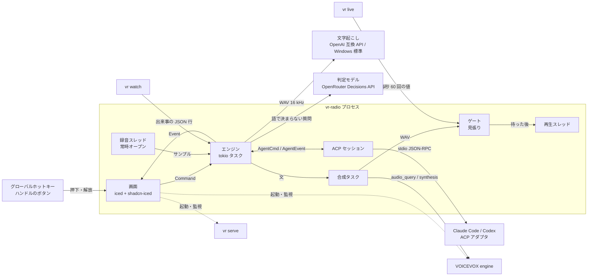
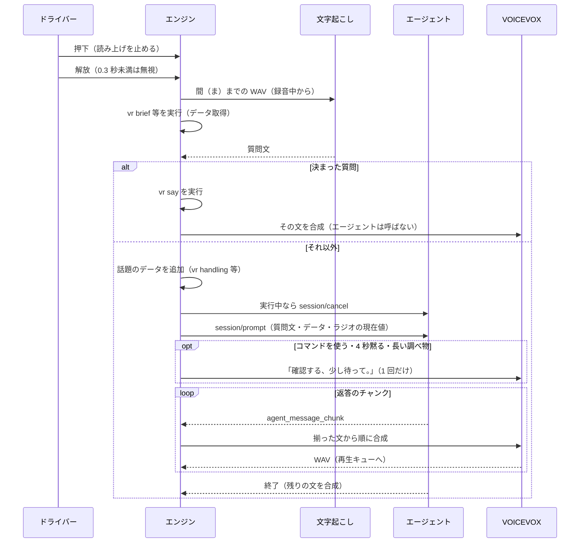
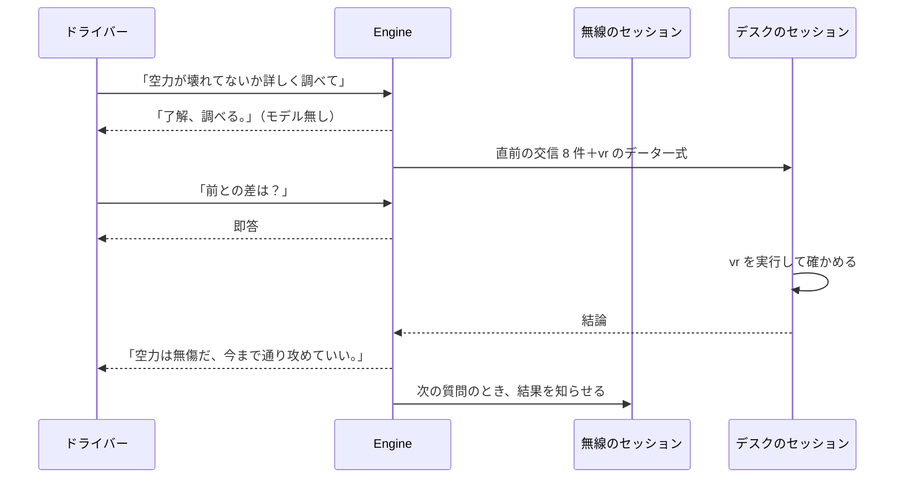
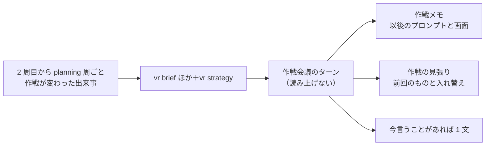

# vr-radio アーキテクチャ

## 概要と基本概念

押している間だけ録音し、文字起こしした質問を ACP でエージェントに送り、返答を文単位で VOICEVOX が読み上げる GUI アプリ。
テレメトリには触れず、`vr` の実行はエージェントに任せる。
レース中の出来事は `vr watch` から受け取り、エンジニアの側から連絡する。

### 設計目標

- **初回音声までの短さ**: 返答の最初の句が揃った時点で合成を開始
- **待たせない準備**: 規則とスキルは接続時に読ませ、データは文字起こしと同時に取得して質問に添付
- **モデルを呼ぶのは考えるときだけ**: 決まった質問・出来事・横の車は、計算した文をそのまま読む。利用枠を使わず、遅れも無い
- **道具の往復を省く**: 質問の話題に応じたデータも先に添付する（エージェントがコマンドを使うと約 3 秒かかる）
- **黙って待たせない**: 調べ物に入るときは、先に「確認する」と伝える
- **話している間の文字起こし**: 間（ま）で区切り、ボタンを離す前に開始
- **常駐セッション**: エージェントのプロセスと ACP セッションを起動時に 1 回だけ作成
- **割り込み**: 話し始めると読み上げを止め、言葉が取れたらエージェントを中断して送る。言葉は失わない
- **手を離さない操作**: 音量・話速・話者・自動連絡は無線で変えられる
- **話しかけ方は言葉で決める**: 黙る条件・見張り・続く指示を、エージェントがドライバーの言葉から組み立てる。判定は条件式で行い、モデルを待たない
- **聞かれる前の作戦**: 裏で作戦を立て直し、変わったことと期限の近いことだけを伝える
- **自動連絡**: 黄旗・順位・損傷などを、聞かれる前に 1 文で伝える
- **黙らない**: エージェントが使えないときも、定型の答えと今の状況は伝える
- **起動は 1 つだけ**: `vr serve`・VOICEVOX・エージェントを自分で起動し、落ちたら起動し直す
- **ハードウェア無しで検証可能**: 録音・文字起こし・合成・再生・エージェントは trait で差し替え

### 用語

| 用語       | 定義                                                            |
| ---------- | --------------------------------------------------------------- |
| ターン     | 1 回の質問と返答。番号で識別し、古いターンのイベントは捨てる    |
| 世代       | 割り込みのたびに増える番号。古い世代の文は合成・再生しない      |
| 連絡       | 出来事をきっかけにエンジニアから始めるターン                    |
| 設定指示   | 返答に書かれた `[[radio キー=値]]`。表示も読み上げもしない      |
| ルール     | 無線で変えられる約束事（`Rules`）。黙る条件・見張り・指示・間隔 |
| 条件式     | ライブ値に対する式。`gap_behind < 1 and lap > 3`                |
| ゲート     | 条件が成り立つ間、文の再生を待たせる仕組み                      |
| 見張り     | 条件が成立した瞬間に、決まった文を読むかエージェントに渡す      |
| 作戦会議   | 読み上げない連絡のターン。作戦メモと見張りを作る                |
| 話題       | 質問が何についてか。`topic` の語、または判定モデルで決める      |
| 即答       | モデルを使わず `vr say` の文で返すこと                          |
| 調査       | 無線とは別のセッション（デスク）が、時間をかけて調べること      |
| スポッター | 横の車を、来た瞬間と離れた後に知らせる仕組み                    |
| 文の区切   | `。！？!?…` と改行、`. `。40 文字を超えたら `、` でも区切る     |
| 許可方針   | エージェントの権限要求への自動応答（`safe`・`all`・`none`）     |

## 実行時の構成

| 実行単位       | 技術形態           | 役割                                      |
| -------------- | ------------------ | ----------------------------------------- |
| 画面           | iced（主スレッド） | 会話・ツール実行・遅延の表示、設定        |
| エンジン       | tokio タスク       | ターン管理、文分割、割り込み              |
| 録音スレッド   | `std::thread`      | 既定マイクを開いたまま、押下中だけ蓄積    |
| 再生スレッド   | `std::thread`      | 既定出力の再生キュー                      |
| ACP セッション | tokio タスク       | 子プロセスのエージェントとの 1 セッション |

マイクと出力を開けない場合も起動し、5 秒ごとに開き直す。その間は文字入力の質問だけ使える。

### 起動するもの

| 対象         | 条件                                            | 失敗・終了時                                        |
| ------------ | ----------------------------------------------- | --------------------------------------------------- |
| `vr serve`   | 窓の起動時（`--serve`、空なら無し）             | 15 秒ごとに再実行（`--if-needed` で重複しない）     |
| `vr live`    | 同上（`--live`、空ならゲートと見張り無し）      | 同上                                                |
| `vr watch`   | 同上（`--watch`、空なら自動連絡無し）           | 1 秒から 30 秒まで間隔を延ばして再実行              |
| VOICEVOX     | ローカルの URL が応答しないとき（`--voicevox`） | 15 秒から 5 分まで間隔を延ばして再実行              |
| エージェント | 常に                                            | 2・5・15・30 秒後に再接続。認証エラーは再接続しない |

- 自分で起動したものだけを終了時に止める
- VOICEVOX の話者一覧は 2 秒ごとに取り直し、60 秒で初めてエラーを出す（以後 10 秒ごと）
- `--ask` では何も起動しない
- 状態は左下の一覧（エージェント・音声・テレメトリ・マイク）に出す。テレメトリは `vr watch` が動き続けていることだけを示し、ゲームの接続は示さない

## コードマップ

| パス                                      | 責務                                           |
| ----------------------------------------- | ---------------------------------------------- |
| [`src/engine.rs`](../src/engine.rs)       | パイプライン、ターン・世代、遅延計測           |
| [`src/agent.rs`](../src/agent.rs)         | ACP クライアント、実行中ターンの取消と次の送信 |
| [`src/policy.rs`](../src/policy.rs)       | 権限要求の自動応答                             |
| [`src/text.rs`](../src/text.rs)           | 文分割、Markdown 除去                          |
| [`src/stt.rs`](../src/stt.rs)             | 文字起こし API、キーの選択、任意の LLM 校正    |
| [`src/early.rs`](../src/early.rs)         | 録音中の文字起こし（区切りと推測）             |
| [`src/vad.rs`](../src/vad.rs)             | 録音中の間（ま）の検出                         |
| [`src/context.rs`](../src/context.rs)     | 質問に添付するデータの取得（`vr brief` 等）    |
| [`src/topic.rs`](../src/topic.rs)         | 質問の語から話題と追加のコマンドを決定         |
| [`src/quick.rs`](../src/quick.rs)         | 即答できる質問の見分けと、定番の誤変換の補正   |
| [`src/calls.rs`](../src/calls.rs)         | 出来事を伝える文（モデル無し）                 |
| [`src/spotter.rs`](../src/spotter.rs)     | 横の車の判定                                   |
| [`src/decide.rs`](../src/decide.rs)       | 判定モデルへの問い合わせ                       |
| [`src/directive.rs`](../src/directive.rs) | 返答の中の設定指示の抽出                       |
| [`src/watch.rs`](../src/watch.rs)         | 出来事の受信、連絡の種類・間隔                 |
| [`src/live.rs`](../src/live.rs)           | ライブ値の受信                                 |
| [`src/expr.rs`](../src/expr.rs)           | 条件式の解析と評価                             |
| [`src/rules.rs`](../src/rules.rs)         | ルール、見張りの成立判定                       |
| [`src/gate.rs`](../src/gate.rs)           | 再生を待つ判断、次に空く区間の予測             |
| [`src/aloud.rs`](../src/aloud.rs)         | 数字の読み（コンマ 1、1 分 55 秒ロクイチイチ） |
| [`src/child.rs`](../src/child.rs)         | 補助プロセスの起動と監視                       |
| [`src/sapi.rs`](../src/sapi.rs)           | Windows 標準の文字起こし（常駐 PowerShell）    |
| [`src/voicevox.rs`](../src/voicevox.rs)   | 話者一覧、音声合成                             |
| [`src/audio.rs`](../src/audio.rs)         | マイク（cpal）・スピーカー（rodio）            |
| [`src/wav.rs`](../src/wav.rs)             | ダウンミックス、リサンプル、WAV 符号化         |
| [`src/app.rs`](../src/app.rs)             | 画面の状態、デバイスとエンジンの結線           |
| [`src/app/view.rs`](../src/app/view.rs)   | 画面のレイアウト                               |
| [`src/fonts.rs`](../src/fonts.rs)         | 同梱フォント（`assets/fonts/`）                |
| [`src/chrome.rs`](../src/chrome.rs)       | ウィンドウ枠（Windows のヒットテスト）         |
| [`src/config.rs`](../src/config.rs)       | 引数・環境変数、Windows の `npx.cmd` 解決      |
| [`src/settings.rs`](../src/settings.rs)   | 設定画面の選択の保存                           |
| [`src/hotkey.rs`](../src/hotkey.rs)       | グローバルキーの登録と割り当て                 |
| [`src/wheel.rs`](../src/wheel.rs)         | ハンドルのボタン（Raw Input）                  |
| [`src/resident.rs`](../src/resident.rs)   | トレイ、自動起動、二重起動の防止               |

## 設計上の不変条件

- **テレメトリ非依存**: workspace の他 crate に依存しない（`crates/vr-cli/tests/architecture.rs`）。データは外部コマンド（`--context`）の出力としてだけ扱う
- **1 セッション 1 ターン**: 新しい質問は実行中のターンを `session/cancel` してから送る
- **言葉を失わない**: 聞き取り中に次を話しても、前の言葉もエージェントに送る（返答は最後の質問の分だけ読み上げる）。送信待ちの言葉は 1 通にまとめる。「止める」だけは捨てる
- **言葉の無い押下は無害**: 短い押下と無音は読み上げを止めるだけで、押している間の文は離した後に読む
- **設定を変えるのはドライバー**: 設定指示は質問のターンでだけ適用し、連絡のターンでは捨てる。作戦会議は作戦メモと自分の見張りだけを書ける（ドライバーの見張りは変えない）
- **永久に黙らない**: ゲートの待ちには上限があり、値が途切れたら開く。急ぐ連絡は 1.5 秒まで
- **運転が先**: ドライバーの発話と急ぐ出来事は、作戦会議を取り消す
- **古いイベントの破棄**: 現在のターン以外のチャンク・ツール通知は表示も読み上げもしない
- **判定モデルに送るのは質問の文だけ**: データも会話の履歴も送らない
- **キーは持ち主のサービスだけに送る**: OpenRouter には `OPENROUTER_API_KEY`、他には `OPENAI_API_KEY`。設定ファイルには保存しない
- **終わらないターンを作らない**: 文字起こしの失敗やエージェント未接続は、そのターンを失敗で終える
- **運転中に確認を出さない**: 権限要求は許可方針で即答。`safe` は読取・検索・取得と、問い合わせの `vr` コマンドだけ許可（`serve`・`record`・`skill`・`sessions delete` は拒否）し、`&` `|` `;` 等で連結したコマンドは拒否
  - Codex は自分の審査で権限を昇格させることがあり、その実行はこの方針を通らない

## 主要な処理フロー

応答の速さと正確さは [vr-eval](../../vr-eval/docs/architecture.md) で測る。

画面には各ターンの「認識」「初回応答」「初回音声」「完了」までの時間を表示。
起点は録音の終了（文字入力では送信）。

## 横断的設計トピック

### 文字起こし

OpenAI 互換の `/audio/transcriptions` を使い、OpenRouter（既定）・OpenAI・Groq・ローカルの whisper サーバーを URL で切り替える。
既定のモデルは `openai/gpt-transcribe`。
2026-11-22 に OpenRouter で比較した結果（VOICEVOX 2 話者 × 4 文、語彙ヒント付き、逐次実行。合成音声だけの小さな比較）。

| モデル                          | 中央値 | 主な誤り                                     |
| ------------------------------- | ------ | -------------------------------------------- |
| `openai/gpt-transcribe`         | 0.74 s | 「はいつ」→「開通」1 件                      |
| `openai/gpt-4o-mini-transcribe` | 1.07 s | 「はいつ」→「あいつ」1 件、「周」→「週」2 件 |
| `assemblyai/universal-3-6-pro`  | 0.44 s | 「周」→「週」「州」、語中の空白              |
| `elevenlabs/scribe-v2`          | 0.98 s | 「はいつ」→「アイツー」、「周」→「週」2 件   |
| `microsoft/mai-transcribe-2`    | 0.82 s | 「イエロー」を `イ**ー` と伏せ字にする       |
| `qwen/qwen3-asr-0.6b`           | 1.03 s | 「周」→「週」4 件、「もつ」→「通」2 件       |
| `qwen/qwen3-asr-1.7b`           | 21 s   | 0.7〜34 s とばらつき、「周」→「週」「州」    |

Windows 標準は SAPI（`System.Speech`）で、API キーも通信も要らないが、レース用語の精度は低い。
Windows PowerShell を常駐させ、WAV を 1 行の base64 で渡す。
Windows AI API の `Microsoft.Windows.AI.Speech` は実験版で、対応言語の記載も無いため使わない。

`--refine-model` を指定すると `/chat/completions` でレース用語を校正する（1 往復増える）。

### 即答

`quick` の語で見分けた質問は `vr say <話題>` の文をそのまま読む。

走行中のドライバーに考える余裕は無い。文は結論と、やることだけにする。

| 言わない                                                 | 言う                                               |
| -------------------------------------------------------- | -------------------------------------------------- |
| 燃料はあと 8 周分、残り 6 周だから足りる                 | 燃料は大丈夫だ、このまま完走する                   |
| 修理の警告は出ているが、修理時間は 0 秒                  | ダメージは軽い、このまま行こう                     |
| 前は 3 番手の 16 号車、1.8 秒差、毎周 0.1 秒縮めてる、…… | 前と 1.8 秒。あと 4 周で追いつく。狙いはセクター 2 |

- 数字は、差やタイムのように数字を聞かれたときに 1 つだけ（0.1 秒単位）
- エージェントにも同じ規則を渡す（走行中は 1〜2 文、60 字まで。聞かれたことは全部答え、詳しくと頼まれたときやチェッカー後は長く話す）
- 他車の状況・攻めどころ・作戦と、行き詰まった訴え（追いつかない、曲がらない）は、走行中でも 3〜4 文、120 字まで。訴えには原因と場所、数字付きの一手、事実での見通しを返す
- 接近戦（前後と 1 秒未満、横に車）の間の質問には「1 文、30 字まで」と添えて送る

- 対象: 順位・前後・トップとの差・ラップ・区間・失っている場所・このままの着順・燃料・残り・旗・天気・損傷・タイヤ・状況
- 定番の誤変換（「今ない」→今何位、「話されて」→離されて）を先に直す
- 「了解」などの相槌、「もう一回」も即答。直前の返答が質問のときは、エージェントへ送る
- 「質問です」「聞こえてる」にも即答する
- 「ピット？」「入る？」「ボックス？」（12 文字まで）は `vr say box`。入る周なら「ボックス、ボックス」、それ以外は「ステイアウト」と予定の周
- 「追いつかない」「抜けない」のような訴えは即答しない。走りと作戦のデータを付けてエージェントに送る
- 3 文字以下で意味の取れない無線には、聞き返さず今の順位とやることを伝える
- 判断・理由・名前・見張り・設定を頼む言葉があれば即答しない。どこで・いつ・誰と・影響・せい（「どこでダメージ食らった」）、他人のファステスト、前の返答の続き（「その」「だから」「そいつ」「同じ」）も即答しない
- 1 つの報告では答えきれない無線も即答しない: 2 つの話題を一度に聞く（「前との差は？後ろは？」）、他の車のタイヤ・燃料・損傷（「トップのタイヤは？」）、変化や計算（「この10周で」「スタートから何個」「もし」「半分」「平均」「一番」「何メートル」「何回出た」「どっち」）
- 語で話題が決まっても、判断モデル（`--decide-model`）に「その話題の定型の文で、聞かれたことに全部答えられるか」を聞いてから読む（約 0.3 秒）。いいえ、または答えが無いときはエージェントが答える。実走の無線 29 件で、違う質問に答える誤りは無く、3 件がエージェントに回った
- エージェントには、即答した交信を次のプロンプトの先頭で知らせる（最大 40 件、一度だけ）
- `quick=off`（画面・無線）か `--say ""` で無効

### 調査

「調べて」「分析して」「推測でいいから」などの依頼は、同じエージェントの別セッション（デスク）が調べる。無線は止まらず、その間も質問に答える。

- 付けるデータ: `brief`・`standings`・`laps --last 60`・`sectors`・`forecast`・`sessions corners`・`handling`・`car`・`strategy` と、話題のデータ
- 無線のエージェントも `[[radio study="…"]]` でデスクに渡せる。ドライバーが調べて・分析して・比べてと頼んだときだけで、ただの質問には付けない（付けると答えが 2 回聞こえ、利用枠も倍かかる）
- 待ち行列は 3 件。調査中の「調べて」だけの催促には「今調べてる」と返す
- 3 分で終わらない調査は打ち切って「調べきれなかった」と伝える。自分からの連絡も 1 分で打ち切る。止まったエージェントが利用枠を使い続けないため
- 読み上げは自動連絡と同じ条件（`hold_calls`）で待つ。途中の発言は読まず、最後の返答だけ読む
- デスクが読んだ大量のデータは無線のセッションに入らない。無線側は短く速いままで、キャッシュも崩れない

### 質問の話題

質問に毎回付くデータ（`--context`）で足りない話題は、文字起こしの直後に語で見分け、そのコマンドの出力も付ける。

| 話題             | 語の例                                               | 追加するコマンド                                                                                                                 |
| ---------------- | ---------------------------------------------------- | -------------------------------------------------------------------------------------------------------------------------------- |
| 挙動・設定       | 曲がらない、バイアス、トラコン                       | `vr handling`、`vr setup`                                                                                                        |
| 車の状態         | タイヤ、ダメージ、水温                               | `vr car`                                                                                                                         |
| 過去のセッション | 前のレース、昨日、予選の                             | `vr sessions list`、`show 1`、`show 2`                                                                                           |
| 番号の車         | `12番`、`#12`、`12号車`                              | `vr gap --car 12`、`vr laps --car 12`                                                                                            |
| 走り             | スプーン、ブレーキポイント、何速、失った、攻め       | `vr sessions corners`、`vr sectors`（後ろの車なら `--car behind` も）                                                            |
| 集計             | 何周分・過去のレースとの比較（質問の語では決めない） | 無線のエージェントが `vr query "SQL"` を 1 回（失敗なら直して 2 回まで）。表と例は `vr query --schema`。答えまで 10 秒ほどかかる |
| 長い調べ物       | 調べて、分析、イシュー                               | 無し（先に「確認する」と伝える）                                                                                                 |
| レース全体       | 一番速い、何台、スタート、何周目、何回出た、もし     | `vr standings`、`vr laps --last 30`、`vr events --limit 100`、`vr forecast`（質問の語だけで決める）                              |

- 差・順位・燃料などの決まった質問は、追加無しですぐに送る
- どちらの語も無い質問だけ判定モデル（`--decide-model`）に聞く。0.8 秒で答えが無ければ、追加無しで送る
- OpenRouter のキーが無いとき、文字起こしが Windows 標準のときは、語だけで決める
- 見落としても、エージェントが自分で `vr` を実行する

判定モデルは文章を作らず、はい・いいえの確率だけを返す。
2026-11-22 に OpenRouter の 32 モデルを 15 問で比べ、上位を 60 問で比べた。
F1 は 4 つの話題の平均（閾値は各モデルの最良）、時間は接続を保ったままの値。

| モデル                             | F1   | 中央値 | 90% 点 | 1000 問    |
| ---------------------------------- | ---- | ------ | ------ | ---------- |
| `typesafe/jev-1.14`（既定）        | 0.93 | 298 ms | 321 ms | 0.027 ドル |
| `cloudflare/clef-omni`             | 0.94 | 318 ms | 365 ms | 0.086 ドル |
| `baseten/mammoth-1`                | 0.93 | 389 ms | 402 ms | 0.047 ドル |
| `microsoft/microsoft-decision-1.1` | 0.91 | 407 ms | 423 ms | 0.016 ドル |
| `openai/gpt-6-luna-decisions`      | 0.94 | 415 ms | 560 ms | 0.090 ドル |
| `liquid/d1-ultra`                  | 0.98 | 425 ms | 478 ms | 0.017 ドル |
| `perplexity/pplx-decider-v1.2`     | 0.96 | 449 ms | 800 ms | 0.008 ドル |
| `liquid/d1.2`                      | 0.96 | 459 ms | 520 ms | 0.008 ドル |

未使用の 35 問では、語だけの見落としは 15 件、Jev を併用すると 3 件（余分 1 件、聞いた質問は 26 件）。
測り直しは `vr-eval topics`（[vr-eval](../../vr-eval/docs/architecture.md)）。

### 調べ物の一言

話し終わりから 8 秒（`--standby`、0 で無し）たっても返答の言葉が無いときだけ、「確認する、少し待って。」と読む。
1 つの質問に 1 回、2 分に 1 回まで。
待たせる一言が続くと、それ自体が運転の邪魔になるからだ。
エージェントがコマンドを使っても、それだけでは言わない（ほとんどは 8 秒以内に答える）。
調査に回した質問は「了解、調べる。」だけを返し、答えが出たら伝える。

連絡のターンとミュート中は言わない。遅延の「初回音声」は返答だけを数える。

### エージェント

`--agent` は ACP アダプタの起動コマンド。設定から切り替えると、古いセッションのタスクを打ち切ってプロセスを終わらせ、新しいセッションを開く。既定は公開から 7 日以上経った版に固定した `@agentclientprotocol/claude-agent-acp`。
エージェントが `vr` を `cargo run` で起動するとビルド待ちで遅いため、`cargo install --path crates/vr-cli` で PATH に置く。

#### 利用枠を使いすぎない

2026-11-22 の 1 時間の走行では、290 回の呼び出しに 6,260 万トークンを使い、5 時間枠を使い切った。
183 回は自動連絡で、うち 126 回は無言だった。会話が積み上がり、1 回あたり最大 45 万トークンになっていた。

| 対策                     | 内容                                                                                                                                                                                                               |
| ------------------------ | ------------------------------------------------------------------------------------------------------------------------------------------------------------------------------------------------------------------ |
| 呼ばない                 | 即答、出来事の定型文、スポッター                                                                                                                                                                                   |
| 頻度の上限               | 自分からの連絡でエージェントを呼ぶのは 30 秒に 1 回まで                                                                                                                                                            |
| 作戦会議を省く           | 燃料が足りて止まる予定も無いレースでは開かない                                                                                                                                                                     |
| セッションを長く保つ     | 回数では替えない。1 回 25.6 万トークン（`--renew-tokens`）を超えたら、空いたときに替える                                                                                                                           |
| 忘れない                 | 替えたときは、直近 40 件の交信・作戦メモ・指示を新しいセッションに渡す                                                                                                                                             |
| 同じデータを送り直さない | 前の質問と出力が変わらないコマンド（`vr sessions analyse`、コーナー表など）は「変わっていない」の 1 行にする。会話はキャッシュから毎回読み直されるため、送ったものはずっと費用になる。セッションを替えたら全部送る |
| 終わらないターン         | 調査は 3 分、自分からの連絡は 1 分で打ち切る。書き直しの依頼は 1 回だけ。調査は無線からしか始まらない                                                                                                              |
| 規則は最初の質問と一緒に | 単独の読み込みターンを無くす                                                                                                                                                                                       |
| Codex の設定を削る       | 使わない機能・指示・リポジトリの `AGENTS.md` を外す。質問前のトークンが約 20,000 から約 6,000 になる                                                                                                               |
| 考える量                 | Codex は無線が 6.1 Terra・low、デスクが medium、高速モードはオフ。どれも設定画面で選べる                                                                                                                           |

無線のプロンプトは末尾に足すだけなので、前の交信はキャッシュから読まれる。
実測では 2 回目以降の 90% 前後がキャッシュで、新しく読むのは 1 回 2,000 トークン前後。
18 分空いてもキャッシュは残っていた。キャッシュの単価が 10 分の 1 なら、25.6 万トークンの会話を読むのは新規の 2.6 万トークンにあたる。

- モデル・考える量・速度の選択肢は、エージェントが ACP の `configOptions` で出したものをそのまま並べる。`--agent-option id=値`・`--desk-option id=値` が設定画面より優先
- Codex の設定は `CODEX_CONFIG` で渡し、利用者の `~/.codex/config.toml` は変えない。`CODEX_CONFIG` を自分で指定していればそれを使う
- 指示文は設定の隣の `codex-instructions.md` に書き出す
- 枠を使い切ったら 1 回だけ声で知らせ、10 分間は自分から呼ばない。質問には今の状況を返す

### 読み方

合成へ渡す直前にだけ [`aloud`](../src/aloud.rs) が書き換え、画面は書かれたまま。モデルを通さないので遅れは無い。

| 書かれたもの | 読み                     |
| ------------ | ------------------------ |
| `0.1秒`      | コンマ 1 秒              |
| `1.2秒`      | 1 秒 2                   |
| `1:55.611`   | 1 分 55 秒ロクイチイチ   |
| `P4`・`#12`  | 4 番手・12 号車          |
| `54.5%`      | そのまま（秒以外の小数） |

### 無線の記録

質問と返答（自動連絡は質問が空）を、時刻とともに 1 行の JSON で `%LOCALAPPDATA%r-radio
adio.jsonl` に書き足す（`--transcript`、空で残さない）。
実際に聞かれた質問を評価の問題に足すためのもので、`vr-eval gold --harvest` が読む。

### 自動連絡

- 出来事の文は [`calls`](../src/calls.rs) が作る。値は `vr watch` の JSON とライブ値。エージェントに聞くのは、文にできないものと `do` の見張りだけ
- 言わないもの: 3x 以下のインシデント、フェーズの変化、自車と他車のピットアウト、ピット中の順位変動、停車中の警告
- 0.7 秒以内の出来事は 1 回にまとめ（順位は最初と最後だけ）、10 秒（作戦は 45 秒）を過ぎたものは捨てる
- 録音・質問・読み上げの間は待つ。急がない連絡は `interval`（既定 8 秒）以上空ける
- 急ぐもの（黄旗・赤旗・黒旗など、インシデント、損傷、燃料不足、ピットの期限、ドライバーの見張り）は間隔を待たない
- 種類ごとに切り替える。既定はラップと車内調整だけオフ。旗の解除は黄旗とコーションだけ
- チェッカーはトップが受けた瞬間ではなく、自分がラインを越えたとき（その周の終わり）に「チェッカー。N位だ」と伝える
- すぐ動く命令は 2 回言う（「イエロー、イエロー」「レッドフラッグ、レッドフラッグ」「コーション、コーション」）。エンジン音で 1 回は聞き落とすため。差や順位は 1 回
- ピットは予告と命令に分ける。止まる周の始めに「この周ボックスだ」、ピットロードの入口の 12〜2% 手前で「ボックス、ボックス」を 1 回（入口を知らなければ、どのコースでも遅すぎない周の 50% で「この周の終わりに入る」と添える）。急ぐ連絡として扱い、作戦の連絡がオフなら言わない
- 伝えた「この周ボックス」が成り立たなくなったら「ステイアウト、ステイアウト」と次の周を伝える

### スポッター

- ゲームの毎フレーム（毎秒 60 回）の値で判定する。左右はゲーム自身の判定（iRacing は `CarLeftRight`）、距離はコース上の位置から求める
- 来たら即座に「左。」「右。」。後ろから 1 秒以内に並ぶ車は、並ぶ前に「後ろ、来る。」
- 離れたら「クリア。」。前後 6 m 以内に車がいなければ 0.08 秒後、いれば 0.25 秒後（ゲームの値のちらつきを除く）
- 居続ける間は 3 秒ごとに「まだ左。」
- 文は起動後に合成し、先頭の無音（約 0.1 秒）を切っておく。読み上げ中でも他の音を下げて重ねる。出力バッファは 512 サンプル
- 用意が間に合わず 0.6 秒遅れたものは言わない
- ブレーキ中も話す。`hold`・ミュート・録音中・`event.spotter=off`・自動連絡オフでは黙る
- 40 km/h 未満・ピットロード・コース外では黙る。値が 1.5 秒途切れたら、覚えていた車を忘れる
- 横の車だけを見る見張りは、スポッターがオンの間は鳴らさない

### ルールと条件式

固定のルールは持たず、部品だけを用意する。ドライバーの言葉から部品を組み合わせるのはエージェントで、組み上がったルールの判定は毎秒 60 回・モデル無しで行う。

| 部品           | 効果                                                                            |
| -------------- | ------------------------------------------------------------------------------- |
| `hold`         | 条件の間、回答も含めて話し始めない。外れるのを待つ                              |
| `hold_calls`   | 同じことを自分からの連絡だけに（既定 `brake > 10`）                             |
| `quiet`        | 条件の間、急がない連絡を捨てる。そのセッション限り                              |
| `when`＋`say`  | 成立した瞬間に、その文を読む。`{gap_behind}` は値になる。エージェントを通さない |
| `when`＋`tell` | 成立した瞬間に、`vr say` の話題を読む。エージェントを通さない                   |
| `when`＋`do`   | 成立した瞬間に、指示をエージェントに渡す（利用枠を使う）                        |
| `note`         | 続く指示。以後のすべてのプロンプトに付く                                        |

- 条件式の値は `vr live` のキー（[`config::LIVE`](../src/config.rs)）。分からない値を含む条件は成立しない（三値論理）
- 見張りは立ち上がりで 1 回。`every` 秒は再通知しない。起動時にすでに成立しているものは知らせない
- 書き間違い（読めない式・無い値）は、次の裏のターンで 1 度だけエージェントに書き直させる

#### ゲートの先読み

前の周のどこで条件が成り立ったかを覚え、文の長さが次のコーナーまでに収まらなければ、収まる区間まで待つ。
どこにも収まらない文は、待てる範囲で最も長い区間で話す。待ちの上限は `hold_max`（既定 8 秒）。

### 裏での作戦立案

- 計算（落ち方・損失・アンダーカット）は `vr strategy`。エージェントは判断と言い方を受け持つ
- 燃料が足りて止まる予定も無いときは開かない
- 3 分以内には繰り返さない。取り消されたら、空いたときにやり直す
- セッションが変わると、メモ・作戦の見張り・`quiet` を捨てる

### 設定指示

`[[radio volume=60]]` の形で、1 つに複数書ける。値は `"…"` や `「…」` で囲める。チャンクの途中で切れていても抽出し、読めないものはエラーとして表示する。

| キー                                           | 値                                                  |
| ---------------------------------------------- | --------------------------------------------------- |
| `volume`                                       | 0〜150（%）。`+20`・`-20` は相対                    |
| `speed`                                        | 0.5〜2.0。`+0.1`・`-0.1` は相対                     |
| `mute`・`proactive`                            | `on`・`off`                                         |
| `speaker`                                      | キャラクター名・スタイル名・両方                    |
| `event.<種類>`                                 | `on`・`off`。種類は出来事の `type` かまとまりの名前 |
| `interval`・`hold_max`                         | 秒。相対も可                                        |
| `hold`・`hold_calls`・`quiet`                  | 条件式、`off`                                       |
| `when` と `do`・`say`・`tell`・`every`・`once` | 見張り 1 件                                         |
| `quick`                                        | `on`・`off`                                         |
| `note`・`forget`                               | 指示の文／`n1`・`w2`・含まれる言葉・`all`           |
| `planning`                                     | 周、`off`                                           |
| `plan`                                         | 作戦メモ                                            |

ミュートと `quiet` は保存しない。ほかは設定画面と同じく保存する。

### 設定画面

歯車から開くモーダル。左のサイドバーで種類を選び、右にその項目だけを出す。

| まとまり   | ページ       | 項目                                         |
| ---------- | ------------ | -------------------------------------------- |
| 無線       | 話す         | 押して話すキー・ハンドルのボタン、文字起こし |
| 無線       | 読み上げ     | 読み上げの有無、音量、話速、話者             |
| エンジニア | 自動連絡     | 出来事の種類、間隔、タイミング               |
| エンジニア | 回答         | 回答のタイミング、即答、作戦立案             |
| エンジニア | 指示と見張り | 無線で頼んだ指示と見張りの一覧・削除         |
| システム   | エージェント | 接続先、モデル・考える量・速度               |
| システム   | アプリ       | トレイ常駐、Windows 起動時の開始             |

画面の構成は設定指示に関係しない。無線で変えた値も同じ設定に入り、開いているページにそのまま出る。

### 設定の保存

設定画面の選択は `settings.json`（Windows は `%APPDATA%\vr-radio\`、`--settings` で変更）に保存。
優先順は、引数・環境変数、設定ファイル、既定値。
壊れた設定ファイルは無視し、上書きもしない。

### 押して話す操作

- グローバルキー: 文字キーは修飾キーとの組み合わせだけ割り当て可（他のアプリの入力を奪うため）
- ハンドル: Raw Input を `RIDEV_INPUTSINK` で受け、ゲームが前面でもボタン数の制限無しに検出
  - ハードウェア ID（VID・PID・インターフェース）で覚え、USB ポートを変えても有効
  - 抜かれた機器のボタンは離したものとして扱う
- 割り当て待ちの間は録音しない

### 常駐

- 「閉じてもトレイに常駐」を選ぶと、ウィンドウを隠すだけで待ち受けを続ける。トレイアイコンが無ければ終了
- 自動起動は `HKCU` の `Run` に `--tray --cwd <作業ディレクトリ>` を登録
- 2 つ目の起動は、名前付きイベントで既存のウィンドウを表示させて終了

### 画面

- ウィンドウ枠は OS のもの。Windows ではキャプションだけを消し、タイトルバーをアプリが描画（[`src/chrome.rs`](../src/chrome.rs)）
  - 角丸・境界線・影・端のリサイズ・Aero Snap は DWM がそのまま担当
  - タイトルバーは `WM_NCHITTEST` で `HTCAPTION` を返し、ドラッグ・ダブルクリック・システムメニューは OS の動作
  - 最大化ボタンは `HTMAXBUTTON` を返し、ホバーで Snap Layouts を表示。見た目はネイティブ側の状態を反映
  - キャプションボタンの字形はシステムの Segoe Fluent Icons（Windows 10 は Segoe MDL2 Assets）
  - 他の OS は OS のタイトルバーをそのまま使用
- 左に状態と操作（状態表示・押して話す・止める）、右に交信ログと文字入力。設定はシートに収納
- 状態は `Phase`（待機・録音・聞き取り・調査・回答・読み上げ）の 1 つだけを表示し、「止める」は処理中だけ有効
- 見た目の確認は `cargo run -p vr-radio --example snapshot`（`target/snapshots/` に PNG を出力。`ICED_TEST_BACKEND=tiny-skia`）

### フォント

Noto Sans JP の静的ウェイト（400・500・700）を JIS 第 1・2 水準の範囲に絞り、`VR Radio Sans` に改名して同梱（`assets/fonts/make_fonts.py`、SIL OFL 1.1）。
システムの可変フォント（Windows の `NotoSansJP-VF.ttf` は既定が Thin）や未導入の環境では、cosmic-text が文字種ごとに別のフォールバックを選び、漢字と仮名の字形が混ざるため。
`--font` で導入済みの別ファミリーに変更可。
