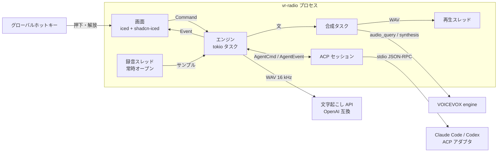
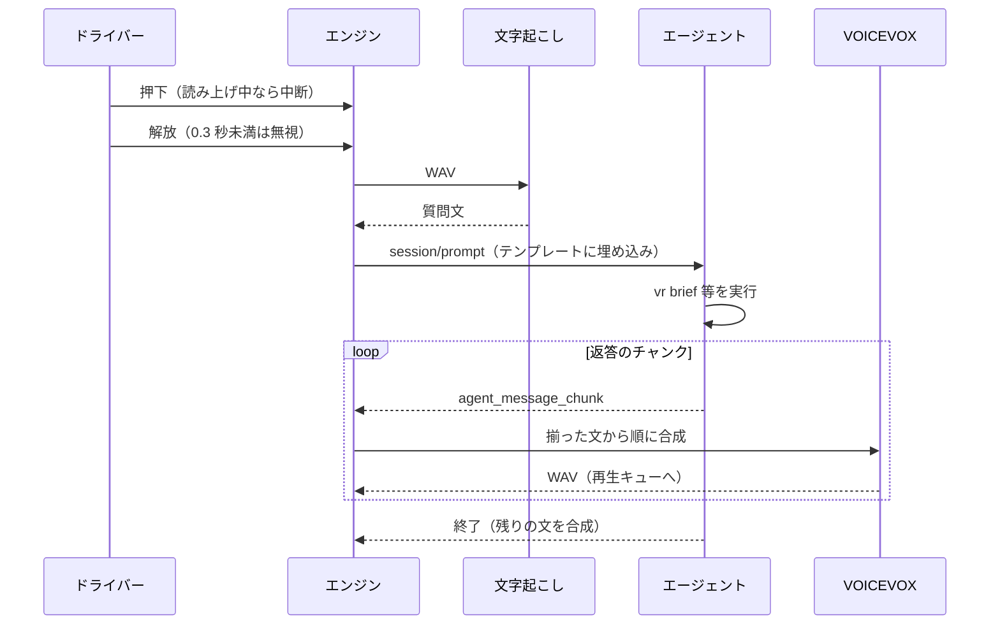

# vr-radio アーキテクチャ

## 概要と基本概念

押している間だけ録音し、文字起こしした質問を ACP でエージェントに送り、返答を文単位で VOICEVOX が読み上げる GUI アプリ。
テレメトリには触れず、`vr` の実行はエージェントに任せる。

### 設計目標

- **初回音声までの短さ**: 返答の最初の 1 文が揃った時点で合成を開始
- **常駐セッション**: エージェントのプロセスと ACP セッションを起動時に 1 回だけ作成
- **割り込み**: 再度話し始めると読み上げとエージェントの処理を中断
- **ハードウェア無しで検証可能**: 録音・文字起こし・合成・再生・エージェントは trait で差し替え

### 用語

| 用語     | 定義                                                         |
| -------- | ------------------------------------------------------------ |
| ターン   | 1 回の質問と返答。番号で識別し、古いターンのイベントは捨てる |
| 世代     | 割り込みのたびに増える番号。古い世代の文は合成・再生しない   |
| 文の区切 | `。！？!?…` と改行、`. `。40 文字を超えたら `、` でも区切る  |
| 許可方針 | エージェントの権限要求への自動応答（`safe`・`all`・`none`）  |

## 実行時の構成

| 実行単位       | 技術形態           | 役割                                      |
| -------------- | ------------------ | ----------------------------------------- |
| 画面           | iced（主スレッド） | 会話・ツール実行・遅延の表示、設定        |
| エンジン       | tokio タスク       | ターン管理、文分割、割り込み              |
| 録音スレッド   | `std::thread`      | 既定マイクを開いたまま、押下中だけ蓄積    |
| 再生スレッド   | `std::thread`      | 既定出力の再生キュー                      |
| ACP セッション | tokio タスク       | 子プロセスのエージェントとの 1 セッション |

マイクと出力を開けない場合は無音の実装で起動し、文字入力の質問だけ使える。

## コードマップ

| パス                                    | 責務                                           |
| --------------------------------------- | ---------------------------------------------- |
| [`src/engine.rs`](../src/engine.rs)     | パイプライン、ターン・世代、遅延計測           |
| [`src/agent.rs`](../src/agent.rs)       | ACP クライアント、実行中ターンの取消と次の送信 |
| [`src/policy.rs`](../src/policy.rs)     | 権限要求の自動応答                             |
| [`src/text.rs`](../src/text.rs)         | 文分割、Markdown 除去                          |
| [`src/stt.rs`](../src/stt.rs)           | 文字起こしと任意の LLM 校正                    |
| [`src/voicevox.rs`](../src/voicevox.rs) | 話者一覧、音声合成                             |
| [`src/audio.rs`](../src/audio.rs)       | マイク（cpal）・スピーカー（rodio）            |
| [`src/wav.rs`](../src/wav.rs)           | ダウンミックス、リサンプル、WAV 符号化         |
| [`src/app.rs`](../src/app.rs)           | 画面の状態、デバイスとエンジンの結線           |
| [`src/app/view.rs`](../src/app/view.rs) | 画面のレイアウト                               |
| [`src/fonts.rs`](../src/fonts.rs)       | 同梱フォント（`assets/fonts/`）                |
| [`src/chrome.rs`](../src/chrome.rs)     | ウィンドウ枠（Windows のヒットテスト）         |
| [`src/config.rs`](../src/config.rs)     | 引数・環境変数、Windows の `npx.cmd` 解決      |

## 設計上の不変条件

- **テレメトリ非依存**: workspace の他 crate に依存しない（`crates/vr-cli/tests/architecture.rs`）
- **1 セッション 1 ターン**: 新しい質問は実行中のターンを `session/cancel` してから送る
- **古いイベントの破棄**: 現在のターン以外のチャンク・ツール通知は表示も読み上げもしない
- **運転中に確認を出さない**: 権限要求は許可方針で即答。`safe` は読取・検索・取得と `vr` コマンドだけ許可し、`&` `|` `;` 等で連結したコマンドは拒否

## 主要な処理フロー

画面には各ターンの「認識」「初回応答」「初回音声」「完了」までの時間を表示。
起点は録音の終了（文字入力では送信）。

## 横断的設計トピック

### 文字起こし

OpenAI 互換の `/audio/transcriptions` を使い、OpenAI・Groq・ローカルの whisper サーバーを URL で切り替える。
`--refine-model` を指定すると `/chat/completions` でレース用語を校正する（1 往復増える）。

### エージェント

`--agent` は ACP アダプタの起動コマンド。既定は公開から 7 日以上経った版に固定した `@agentclientprotocol/claude-agent-acp`。
エージェントが `vr` を `cargo run` で起動するとビルド待ちで遅いため、`cargo install --path crates/vr-cli` で PATH に置く。

### 画面

- ウィンドウ枠は OS のもの。Windows ではキャプションだけを消し、タイトルバーをアプリが描画（[`src/chrome.rs`](../src/chrome.rs)）
  - 角丸・境界線・影・端のリサイズ・Aero Snap は DWM がそのまま担当
  - タイトルバーは `WM_NCHITTEST` で `HTCAPTION` を返し、ドラッグ・ダブルクリック・システムメニューは OS の動作
  - 最大化ボタンは `HTMAXBUTTON` を返し、ホバーで Snap Layouts を表示。見た目はネイティブ側の状態を反映
  - キャプションボタンの字形はシステムの Segoe Fluent Icons（Windows 10 は Segoe MDL2 Assets）
  - 他の OS は OS のタイトルバーをそのまま使用
- 左に状態と操作（状態表示・押して話す・止める）、右に交信ログと文字入力。設定はシートに収納
- 状態は `Phase`（待機・録音・聞き取り・調査・回答・読み上げ）の 1 つだけを表示し、「止める」は処理中だけ有効
- 見た目の確認は `cargo run -p vr-radio --example snapshot`（`target/snapshots/` に PNG を出力。`ICED_TEST_BACKEND=tiny-skia`）

### フォント

Noto Sans JP の静的ウェイト（400・500・700）を JIS 第 1・2 水準の範囲に絞り、`VR Radio Sans` に改名して同梱（`assets/fonts/make_fonts.py`、SIL OFL 1.1）。
システムの可変フォント（Windows の `NotoSansJP-VF.ttf` は既定が Thin）や未導入の環境では、cosmic-text が文字種ごとに別のフォールバックを選び、漢字と仮名の字形が混ざるため。
`--font` で導入済みの別ファミリーに変更可。
