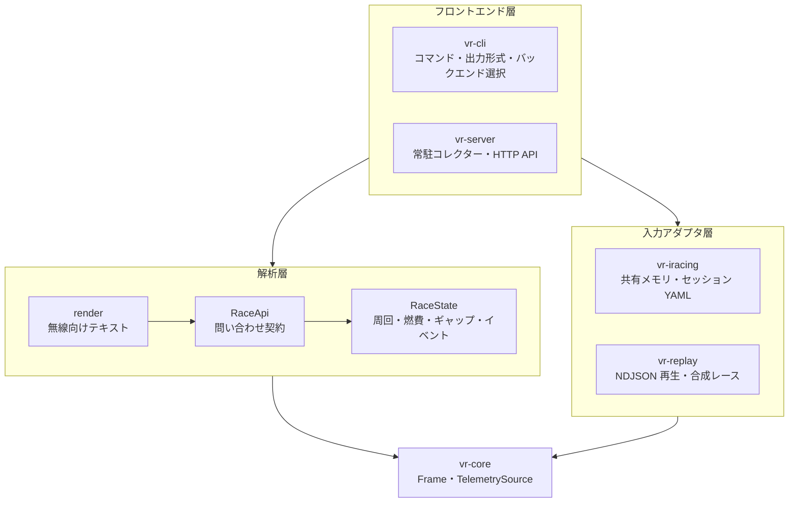
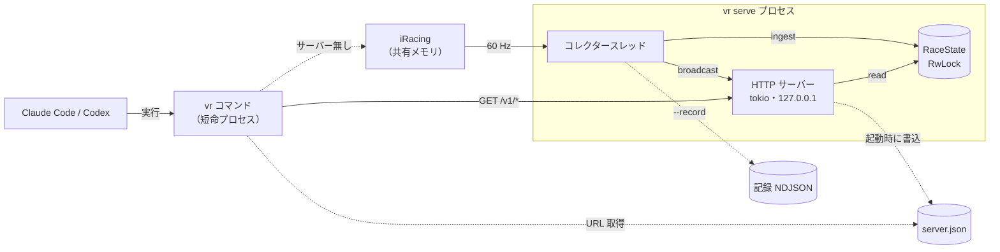
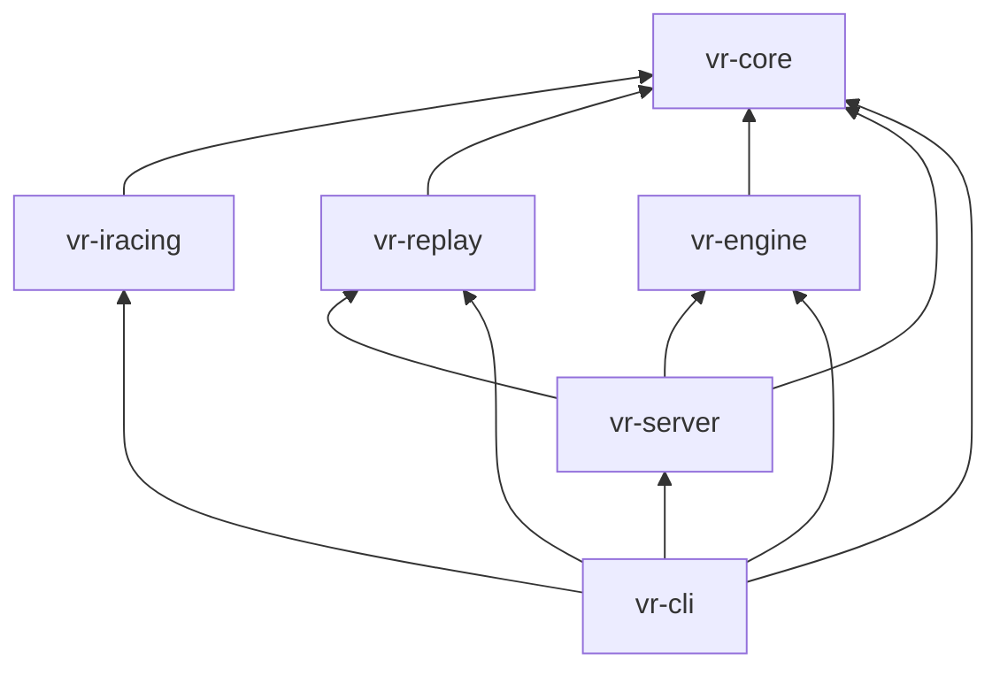
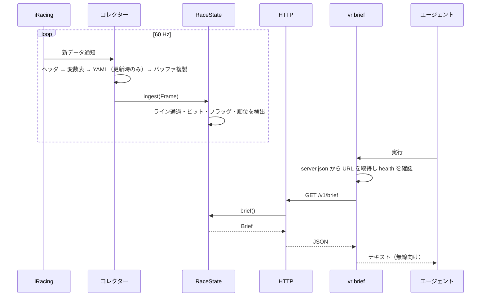
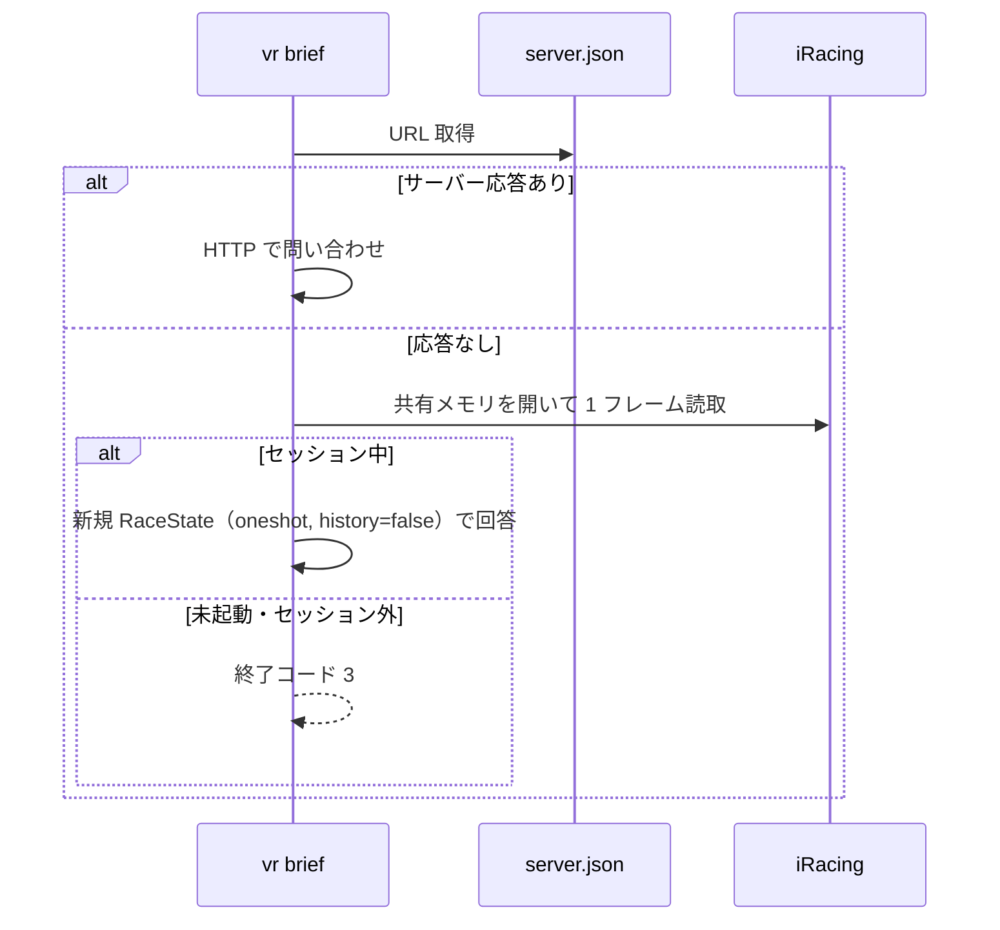

# アーキテクチャ

## 概要と基本概念

vibe-racing は、レースゲームのテレメトリを読み、AI エージェントがレースエンジニアとして無線の質問に答えるための CLI `vr` である。
ゲーム固有の読み取りは入力アダプタに閉じ込め、解析と問い合わせはゲーム非依存の層で行う。
問い合わせ面は `RaceApi` の 1 つだけで、CLI・HTTP・将来の MCP はすべてその上に載る。

### 基本モデル

- **正規化フレーム**: 各ゲームのテレメトリを `Frame`（SI 単位、未対応項目は `None`）へ変換したもの
- **テレメトリソース**: `Frame` を逐次返す `TelemetrySource`。ライブゲーム・記録再生・合成レースが同じ trait を実装
- **レース状態**: `RaceState` がフレームを 1 枚ずつ取り込み、周回記録・燃費・ギャップ推移・イベントを蓄積
- **問い合わせ API**: `RaceApi`（`brief`・`standings`・`gaps`・`fuel`・`laps`・`events`・`snapshot`）。レスポンス型は JSON の互換契約

### 設計目標

- **応答性**: 無線の質問に 1 コマンド・数十 ms で答える（`vr brief` に必要情報を集約）
- **拡張性**: ゲーム追加はアダプタ crate 1 つ、フロントエンド追加は `RaceApi` の利用だけで完結
- **正確さ**: 推定値と実測値を区別して出力（`basis`・`mode`・`history`・`age_ms`）
- **ゲーム無しでの検証**: 合成レースと記録再生で全層を試験可能

### 用語

| 用語               | 定義                                                                     |
| ------------------ | ------------------------------------------------------------------------ |
| 常駐コレクター     | `vr serve` 内でソースを全レートで読み続けるスレッド                      |
| ワンショット       | サーバー無しで共有メモリを 1 回だけ読む動作。履歴なし                    |
| クリーンラップ     | ピットレーン通過も黄旗も無い周。平均ペース・燃費の母集団                 |
| ギャップ推移       | 自車のライン通過ごとに記録した他車との差の変化量（秒/周）                |
| 近傍車             | 自車の ±2 位以内（マルチクラスではクラス内）。他車のピットイベントの対象 |
| discovery ファイル | `vr serve` が書く `server.json`。CLI が URL を見つける手掛かり           |

## 階層構造と実行時アーキテクチャ

### 全体の階層構造

- 解析層は具体的なアダプタを知らない。`vr-engine` が `vr-replay` に依存するのはテストのみ
- アダプタの選択はフロントエンド（`crates/vr-cli/src/sources.rs`）が `SourceFactory` として注入

### 実行時の構成

| 実行単位           | 技術形態      | 役割                                              | 生存期間               |
| ------------------ | ------------- | ------------------------------------------------- | ---------------------- |
| `vr serve`         | 単一プロセス  | 収集・集計・API 提供                              | 走行セッション中ずっと |
| コレクタースレッド | `std::thread` | ソースの読取と `RaceState` 更新、切断時の再接続   | `vr serve` と同じ      |
| HTTP サーバー      | tokio + axum  | `RaceApi` の JSON 公開、SSE 配信                  | `vr serve` と同じ      |
| `vr <query>`       | 短命プロセス  | サーバーへの問い合わせ またはワンショット読取 | 1 コマンド             |

### 境界と永続化

| 境界           | 方式                                                                                  | 所有者                                           |
| -------------- | ------------------------------------------------------------------------------------- | ------------------------------------------------ |
| ゲーム → `vr`  | iRacing 共有メモリ `Local\IRSDKMemMapFileName`（読取専用） と新データ通知イベント | iRacing                                          |
| CLI → サーバー | HTTP/JSON、`127.0.0.1` 限定、既定ポート 47800                                         | `vr-server`                                      |
| イベント配信   | SSE `/v1/events/stream`（event 名 `race`）                                            | `vr-server`                                      |
| サーバー発見   | `%LOCALAPPDATA%\vibe-racing\server.json` （`VR_DISCOVERY` で上書き）              | 書いた `vr serve`。終了時に自 PID のものだけ削除 |
| 記録           | 正規化 `Frame` の NDJSON（既定 10 Hz に間引き）                                       | 利用者                                           |

`RaceState` はメモリ上にのみ存在する。`vr serve` を止めると履歴は消える。

## コードマップと依存関係

### 依存の向き

- `vr-core` は workspace 内のどの crate にも依存しない
- 入力アダプタ同士、およびアダプタと `vr-engine` は互いに依存しない
- `vr-server` が `vr-replay` を使うのは記録（`Recorder`）のため

### 構成要素の対応

| 層     | パス                                                                  | 責務                                                                  | 変更頻度 |
| ------ | --------------------------------------------------------------------- | --------------------------------------------------------------------- | -------- |
| 共通型 | [`crates/vr-core`](../crates/vr-core)                                 | `Frame`・`TelemetrySource`・`Capabilities`                            | 低       |
| 入力   | [`crates/vr-iracing`](../crates/vr-iracing)                           | ヘッダ・変数表の解析、YAML サニタイズ、`Frame` 変換、Win32 マッピング | 中       |
| 入力   | [`crates/vr-replay`](../crates/vr-replay)                             | NDJSON 記録・再生、ペーシング、合成レース                             | 低       |
| 解析   | [`crates/vr-engine/src/state.rs`](../crates/vr-engine/src/state.rs)   | 周回確定、燃費・ギャップ・近傍車、イベント検出                        | 高       |
| 解析   | [`crates/vr-engine/src/api.rs`](../crates/vr-engine/src/api.rs)       | `RaceApi` と引数型、`SharedState` への委譲                            | 中       |
| 解析   | [`crates/vr-engine/src/report.rs`](../crates/vr-engine/src/report.rs) | レスポンス型（JSON 契約）                                             | 低       |
| 解析   | [`crates/vr-engine/src/render.rs`](../crates/vr-engine/src/render.rs) | エージェント向けテキスト整形                                          | 中       |
| 配信   | [`crates/vr-server`](../crates/vr-server)                             | コレクター、HTTP・SSE、discovery                                      | 低       |
| CLI    | [`crates/vr-cli`](../crates/vr-cli)                                   | コマンド定義、ソース登録、バックエンド選択、`doctor`、スキル同梱      | 中       |
| スキル | [`skills/race-engineer`](../skills/race-engineer)                     | エージェントの手順と返答規範（`vr` バイナリに埋め込み）               | 中       |

## 設計上の不変条件

- **ゲーム非依存の境界**: ゲーム固有の値（iRacing のビットフィールド、kg/h、`-1` や `604800` の番兵値）はアダプタ内で正規化する。`vr-engine` 以上に持ち込まない
- **問い合わせ面の一本化**: フロントエンドは `RaceApi` 経由でのみ状態を読む。`HttpClient` と `RaceState` は同じ trait を実装し、コマンド側は区別しない
- **JSON 互換**: `report.rs` の型は HTTP と `-f json` の契約。フィールドの削除・意味変更をしない
- **推定の明示**: 推定値には根拠を付ける（`FuelBasis`・`GapMode`・`history`・`age_ms`）。欠損は `None` で返し、0 で埋めない
- **共有メモリの整合性**: データバッファを複製した後にその tick を読み直し、変化していれば破棄する
- **ローカル限定**: HTTP は `127.0.0.1` にのみバインドする
- **スキルの正本**: `skills/race-engineer/` が唯一の正本。配布は `vr skill install` によるコピーのみ

## 主要な処理フロー

### ライブ走行中の無線質問

### 周回の確定

1. 車の `laps_completed` が増えたら保留ラップを作成する（ピット・黄旗・燃料差分を確定）
2. ゲームが新しいラップタイムを公開した時点で記録する
3. 同一タイムで変化が見えない場合は 3 秒後に表示値で確定する

自車の周回確定時、レース中であれば全車とのギャップを標本化し、推移の計算に使う。

### サーバー不在時のフォールバック

`--game` / `--file` を指定した場合はサーバーを使わず、ソースを最後（または `--until`）まで流してから回答する。

## 横断的設計トピック

### 拡張方式

- **ゲーム追加**: `TelemetrySource` を実装する crate を作り、`crates/vr-cli/src/sources.rs` の `Game` に登録する。提供できない値は `None`、可否は `Capabilities` で宣言する
- **MCP 化**: `RaceApi` をツールとして公開する crate を追加する。プロセス内（`SharedState`）でも `vr serve` 経由（`HttpClient`）でも同じ trait で書ける。テキスト出力には各レポートの `to_text()` を使う

### 障害と再接続

- ライブソースが `Disconnected` を返すと、コレクターは `connected=false` にして 2 秒後に開き直す
- 有限ソース（再生・合成）は終端で停止し、最終状態の提供を続ける
- `Unsupported`（Windows 以外）など回復不能なエラーではコレクターを止める
- セッション番号の変化で周回・フラッグ・順位・自己ベストの履歴を破棄する
- 停止時、SSE 接続の終了待ちは 1 秒で打ち切る

### セッション YAML

iRacing のセッション情報はドライバー名等を引用符なしで出力するため、`: ` や `#` を含む値で YAML として壊れる。
自由記述キーの値を単引用符で囲んでから汎用 `Value` として読み、必要なフィールドだけを取り出す。
解析に失敗した更新は無視し、直前の情報を使い続ける。

### 性能

- コレクターは 1 フレームごとに書込ロックを短時間取る。問い合わせは読込ロックのみ
- 記録は既定 10 Hz に間引く（1 フレームが数 KB〜十数 KB の JSON になるため）
- イベントログは最新 1000 件、車ごとの周回記録は 200 周で打ち切る

## 関連文書

| 文書                                                                                          | 内容                                                           |
| --------------------------------------------------------------------------------------------- | -------------------------------------------------------------- |
| [development.md](development.md)                                                              | ビルド・テスト・カバレッジ・ミューテーションテスト・記録の扱い |
| [skills/race-engineer/references/commands.md](../skills/race-engineer/references/commands.md) | コマンド・JSON フィールド・HTTP エンドポイントの仕様           |
| [skills/race-engineer/SKILL.md](../skills/race-engineer/SKILL.md)                             | エージェントの手順と返答規範                                   |
