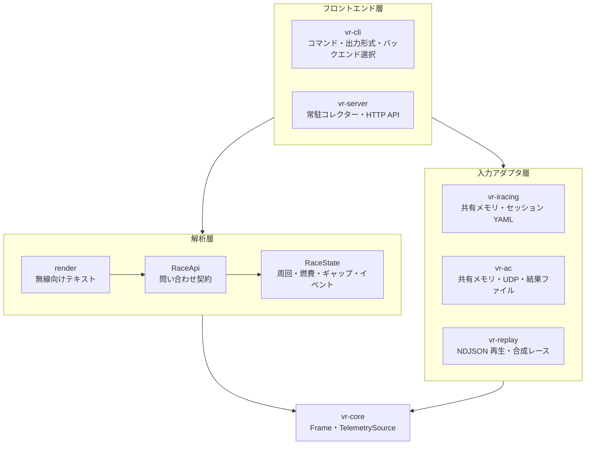
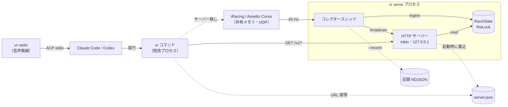
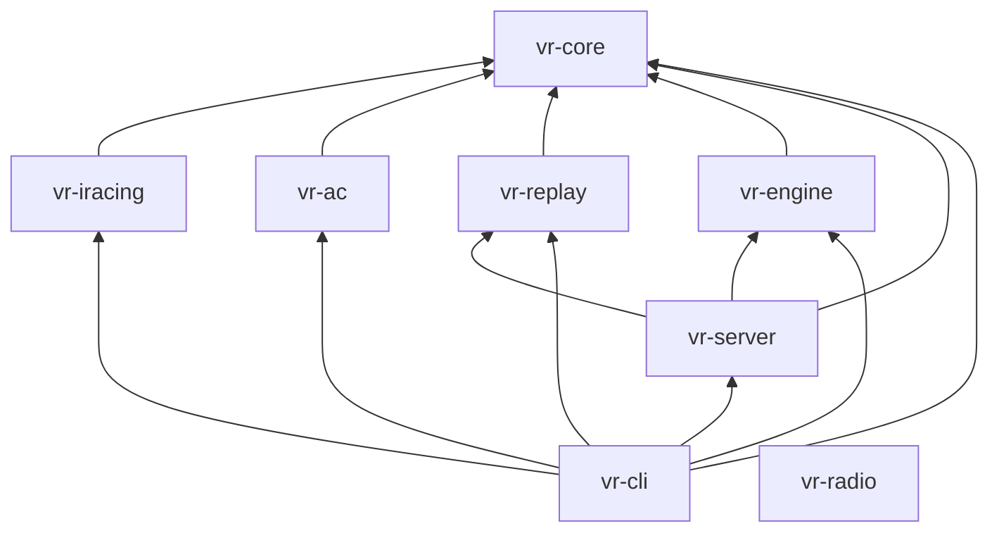
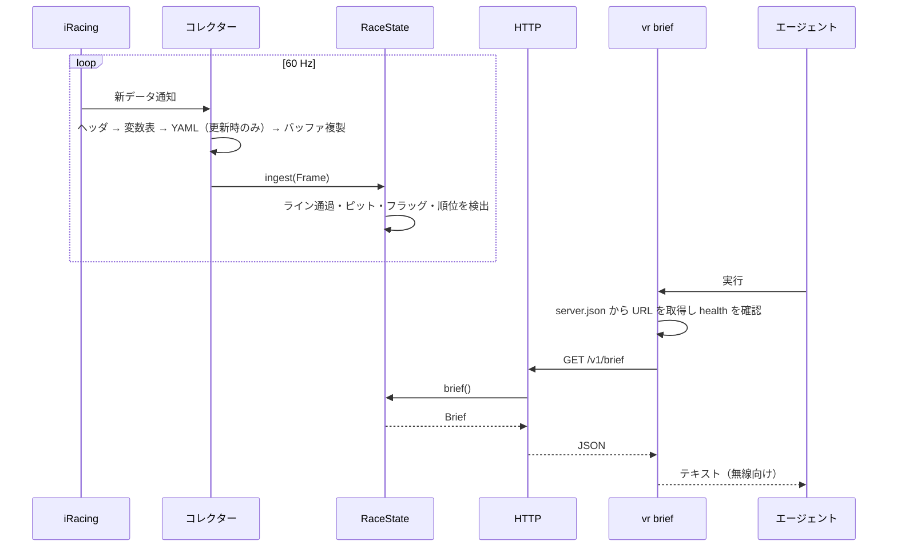
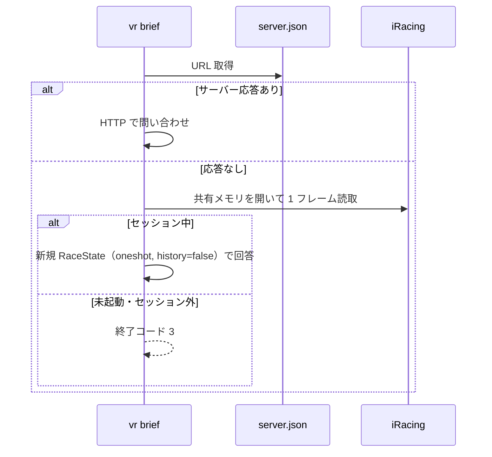

# アーキテクチャ

## 概要と基本概念

ゲームのテレメトリを解析し、エージェントの無線回答に必要な情報を返す CLI `vr`。
ゲーム固有の処理は入力アダプタに限定し、問い合わせは `RaceApi` に一本化。
音声無線アプリ `vr-radio` は、声をエージェントに渡し、返答を読み上げる。

### 基本モデル

- **正規化フレーム**: `Frame`（SI 単位、未対応項目は `None`）
- **テレメトリソース**: `Frame` を返す `TelemetrySource`。ライブ・記録再生・合成レースが実装
- **レース状態**: `RaceState` が周回・燃費・ギャップ推移・イベントを蓄積
- **付随データ**: `Extras`。毎フレームには重い値（ゲームの全変数・セッション情報・セットアップ）を約 1 秒ごとに取得
- **セッション記録**: `SessionRecord`。セッションの結果・周回・イベント・挙動を 1 ファイルに保存
- **問い合わせ API**: `RaceApi`。レスポンス型は JSON の互換契約

### 設計目標

- **応答性**: 1 コマンド・数十 ms で回答（`vr brief`）
- **拡張性**: ゲーム追加はアダプタ crate 1 つ、フロントエンド追加は `RaceApi` の利用のみ
- **正確さ**: 推定値と実測値を区別（`basis`・`mode`・`history`・`age_ms`）
- **ゲーム無しで検証可能**: 合成レースと記録再生

### 用語

| 用語               | 定義                                                                              |
| ------------------ | --------------------------------------------------------------------------------- |
| 常駐コレクター     | `vr serve` 内でソースを読み続けるスレッド                                         |
| ワンショット       | サーバー無しで共有メモリを 1 回だけ読む動作。履歴なし                             |
| クリーンラップ     | ピットレーン通過も黄旗も無い周。平均ペース・燃費の母集団                          |
| ギャップ推移       | 自車のライン通過ごとに記録した他車との差の変化量（秒/周）                         |
| 近傍車             | 自車の ±2 位以内（マルチクラスではクラス内）。他車のピットイベントの対象          |
| 挙動の傾向         | 入力と車の動きから推定した、アンダー・オーバー・空転・ロックの時間（秒/周）       |
| 車内設定           | 走行中に変えられる項目（`Control`）。BB・TC など                                  |
| タイムの落ち       | スティント内で 1 周ごとに遅くなる秒数。タイヤの劣化から燃料の軽さを差し引いた実測 |
| ピットロス         | ストップ 1 回の損失。ラップの実測から求める                                       |
| 四輪の実測         | 記録ファイルにだけある車輪ごとの値（`Wheels`）から求めたロック・車高など          |
| ライブ値           | 刻々と変わる値を平らな数値の組にしたもの（`vr live`）                             |
| discovery ファイル | `vr serve` が書く `server.json`。CLI はここから URL を取得                        |

## 階層構造と実行時アーキテクチャ

### 全体の階層構造

- 解析層はアダプタに依存しない（`vr-engine` → `vr-replay` はテストのみ）
- アダプタは `crates/vr-cli/src/sources.rs` が `SourceFactory` として注入

### 実行時の構成

| 実行単位           | 技術形態      | 役割                                              | 生存期間               |
| ------------------ | ------------- | ------------------------------------------------- | ---------------------- |
| `vr serve`         | 単一プロセス  | 収集・集計・API 提供                              | 走行セッション中ずっと |
| コレクタースレッド | `std::thread` | ソースの読取と `RaceState` 更新、切断時の再接続   | `vr serve` と同じ      |
| HTTP サーバー      | tokio + axum  | `RaceApi` の JSON 公開、SSE 配信                  | `vr serve` と同じ      |
| `vr <query>`       | 短命プロセス  | サーバーへの問い合わせ またはワンショット読取 | 1 コマンド             |
| `vr-radio`         | GUI プロセス  | 音声入力・エージェント呼出・読み上げ              | 利用者が閉じるまで     |

### 境界と永続化

| 境界           | 方式                                                                                                                                                      | 所有者                                                                    |
| -------------- | --------------------------------------------------------------------------------------------------------------------------------------------------------- | ------------------------------------------------------------------------- |
| ゲーム → `vr`  | iRacing 共有メモリ `Local\IRSDKMemMapFileName`（読取専用） と新データ通知イベント                                                                     | iRacing                                                                   |
| ゲーム → `vr`  | Assetto Corsa 共有メモリ `Local\acpmf_*`（読取専用、4 ms ごとに確認） または UDP 9996、`race_out.json`（[一覧](../crates/vr-ac/docs/data.md)）   | Assetto Corsa・CrewChief のアプリ                                         |
| CLI → サーバー | HTTP/JSON、`127.0.0.1` 限定、既定ポート 47800                                                                                                             | `vr-server`                                                               |
| 過去の画面     | `GET /`（ブラウザ）と `/v1/sessions`、周の波形 `…/laps`。読み取り専用                                                                                     | `vr-server`                                                               |
| イベント配信   | SSE `/v1/events/stream`（event 名 `race`）                                                                                                                | `vr-server`                                                               |
| サーバー発見   | `%LOCALAPPDATA%\vibe-racing\server.json` （`VR_DISCOVERY` で上書き）                                                                                  | 書いた `vr serve`。終了時に自 PID のものだけ削除                          |
| 記録           | 正規化 `Frame` の NDJSON（既定 10 Hz に間引き）                                                                                                           | 利用者                                                                    |
| セッション     | `%LOCALAPPDATA%\vibe-racing\sessions\<id>.json` （`VR_SESSIONS` で上書き）                                                                            | `vr serve` が 30 秒ごと・終了時・切断時に保存                             |
| 周の波形       | 同じ場所の `<id>.laps\`（1 周 1 ファイル、約 43 KB）                                                                                                      | 周の終わりに保存。距離で 1000 点に揃える                                  |
| 走行の全記録   | 同じ場所の `<id>.lake\`（Parquet。`telemetry` 自車の毎フレーム、`cars` 全車 10 Hz、`corners` 周ごとのコーナー、`crossings` 全車が各コーナーに入った時刻） | `vr serve` が 5 秒ごと・周の終わり・切断時に書き足す。読むのは `vr query` |

`vr query` は、保存したファイルを埋め込みの DuckDB で読む（[`lake`](../crates/vr-server/src/lake.rs)）。別のサーバーは置かない。
Parquet は一度書いたら変えないファイルを足していく。書き途中は別名で書いて名前を変えるので、読み手が半端なファイルを見ることはない。
`laps`・`events`・`sessions` の表は、セッションの JSON をそのまま読む。
集計の間違いが多い計算（ピット・黄旗・1 周目を除いたペース、コーナーごとのロス合計、出来事の周）は、`lap_stats`・`corner_stats`・`events.lap` として用意する。
`crossings` は全車のコーナーの境目の通過を毎フレーム補間して記録し、`car_corners`（全車の周ごとのコーナータイム）と `corner_field`（コーナーごとに自分と最速の車）になる。名前のないコースは 1 周を 20 等分する。
`brakes` は自車の毎フレームから、止まるたびのブレーキの踏み始め・離し・最低速度・アクセルを戻した位置を求める（約 1 m 単位）。
問い合わせは読み取り専用で、1 文の SELECT（WITH・FROM・DESCRIBE・SUMMARIZE・SHOW）だけ、20 秒・200 行まで。
走行中の無線の即答は今までどおり `RaceState` から計算し、SQL は調べ物とレース後の集計に使う。
`vr sessions lake` は、`vr query` 以前に残した周の波形から `corners` を作る。

`RaceState` はメモリ上のみ。`vr serve` の停止で、走行中の平均や推移は消える。保存済みのセッションは残り、再起動後の同じセッションと結合する。

## コードマップと依存関係

### 依存の向き

- `vr-server` → `vr-replay` は記録（`Recorder`）用
- `vr-radio` は workspace の crate に依存しない。テレメトリはエージェントが `vr` で取得
- 許可する依存は [`crates/vr-cli/tests/architecture.rs`](../crates/vr-cli/tests/architecture.rs) が `cargo metadata` で検査（dev-dependencies は対象外）

### 構成要素の対応

| 層     | パス                                                                      | 責務                                                                   | 変更頻度 |
| ------ | ------------------------------------------------------------------------- | ---------------------------------------------------------------------- | -------- |
| 共通型 | [`crates/vr-core`](../crates/vr-core)                                     | `Frame`・`TelemetrySource`・`Capabilities`                             | 低       |
| 入力   | [`crates/vr-iracing`](../crates/vr-iracing)                               | ヘッダ・変数表の解析、YAML サニタイズ、`Frame` 変換、Win32 マッピング  | 中       |
| 入力   | [`crates/vr-ac`](../crates/vr-ac)                               | 全ページ・UDP の配置、`Frame` 変換、セッションの時計、Win32 マッピング | 中       |
| 入力   | [`crates/vr-replay`](../crates/vr-replay)                                 | NDJSON 記録・再生、ペーシング、合成レース                              | 低       |
| 解析   | [`crates/vr-engine/src/state.rs`](../crates/vr-engine/src/state.rs)       | 周回確定、燃費・ギャップ・近傍車、イベント検出                         | 高       |
| 解析   | [`crates/vr-engine/src/api.rs`](../crates/vr-engine/src/api.rs)           | `RaceApi` と引数型、`SharedState` への委譲                             | 中       |
| 解析   | [`crates/vr-engine/src/report.rs`](../crates/vr-engine/src/report.rs)     | レスポンス型（JSON 契約）                                              | 低       |
| 解析   | [`crates/vr-engine/src/render.rs`](../crates/vr-engine/src/render.rs)     | エージェント向けテキスト整形                                           | 中       |
| 解析   | [`crates/vr-engine/src/handling.rs`](../crates/vr-engine/src/handling.rs) | 挙動の傾向の推定                                                       | 中       |
| 解析   | [`crates/vr-engine/src/trace.rs`](../crates/vr-engine/src/trace.rs)       | 周ごとの波形、コーナーの比較（`vr sessions corners`）                  | 中       |
| 解析   | [`crates/vr-engine/src/strategy.rs`](../crates/vr-engine/src/strategy.rs) | 落ち方、ピットロス、止まる周の案、アンダーカット                       | 中       |
| 解析   | [`crates/vr-engine/src/timing.rs`](../crates/vr-engine/src/timing.rs)     | 全車の通過時刻、区間タイム、今この瞬間の差                             | 中       |
| 解析   | [`crates/vr-engine/src/forecast.rs`](../crates/vr-engine/src/forecast.rs) | このままの着順、誰といつ会うか（`vr forecast`）                        | 中       |
| 解析   | [`crates/vr-engine/src/speech.rs`](../crates/vr-engine/src/speech.rs)     | 決まった質問への日本語の結論（`vr say`）                               | 中       |
| 解析   | [`crates/vr-engine/src/live.rs`](../crates/vr-engine/src/live.rs)         | ライブ値                                                               | 低       |
| 解析   | [`crates/vr-engine/src/chassis.rs`](../crates/vr-engine/src/chassis.rs)   | 四輪の実測の集計                                                       | 中       |
| 解析   | [`crates/vr-engine/src/garage.rs`](../crates/vr-engine/src/garage.rs)     | ガレージの打ち手、変更の前後・走行どうしの比較                         | 中       |
| 解析   | [`crates/vr-engine/src/advice.rs`](../crates/vr-engine/src/advice.rs)     | 傾向からの変更案（経験則）                                             | 中       |
| 解析   | [`crates/vr-engine/src/archive.rs`](../crates/vr-engine/src/archive.rs)   | `SessionRecord` の作成と結合                                           | 低       |
| 配信   | [`crates/vr-server`](../crates/vr-server)                                 | コレクター、HTTP・SSE、discovery、セッションの保存                     | 低       |
| 配信   | [`crates/vr-server/src/lake.rs`](../crates/vr-server/src/lake.rs)         | 走行の全記録（Parquet）と SQL の問い合わせ（`vr query`、DuckDB）       | 中       |
| CLI    | [`crates/vr-cli`](../crates/vr-cli)                                       | コマンド定義、ソース登録、バックエンド選択、`doctor`、スキル同梱       | 中       |
| スキル | [`skills/race-engineer`](../skills/race-engineer)                         | エージェントの手順と返答規範（`vr` バイナリに埋め込み）                | 中       |
| 評価   | [`crates/vr-eval`](../crates/vr-eval)                                     | 音声無線の端から端までの評価                                           | 中       |
| 音声   | [`crates/vr-radio`](../crates/vr-radio)                                   | 録音・文字起こし・ACP クライアント・VOICEVOX 読み上げ・画面            | 中       |

## 設計上の不変条件

- **ゲーム非依存の境界**: ゲーム固有の値（iRacing のビットフィールド、kg/h、`-1` や `604800` の番兵値、Assetto Corsa の psi・左手系の軸・ms）はアダプタ内で正規化。`Extras` の `channels`・`info` だけはゲームの名前のまま通し、解析には使わない
- **問い合わせ面の一本化**: フロントエンドは `RaceApi` 経由でのみ状態を読む（`HttpClient` と `RaceState` が実装）
- **JSON 互換**: `report.rs` の型は HTTP と `-f json` の契約。フィールドの削除・意味変更は禁止
- **推定の明示**: 推定値には根拠（`FuelBasis`・`GapMode`・`history`・`age_ms`）を付け、欠損は 0 で埋めず `None`
- **収集を止めない**: 収集スレッドは、コンソールやパイプへの書き込みを待たない（ログは専用スレッドが書き、溢れた行は捨てる）
- **共有メモリの整合性**: バッファ複製後に tick を再確認し、変化していれば破棄
- **ローカル限定**: HTTP は `127.0.0.1` のみ
- **スキルの正本**: `skills/race-engineer/`。配布は `vr skill install` のみ
- **依存の向き**: 上図以外の crate 間依存は禁止。新しい crate は規則と本文書の更新が必要

## 主要な処理フロー

### ライブ走行中の無線質問

### 周回の確定

1. `laps_completed` の増加で保留ラップを作成（ピット・黄旗・燃料差分を確定）
2. 新しいラップタイムの公開で記録
3. タイムが変わらなければ 3 秒後に表示値で確定

レース中は自車の周回確定ごとに全車とのギャップを標本化し、推移を計算。

### サーバー不在時のフォールバック

`--game` / `--file` 指定時はサーバーを使わず、ソースを最後（または `--until`）まで流して回答。

## 横断的設計トピック

### 拡張方式

- **ゲーム追加**: `TelemetrySource` を実装する crate を作り、`crates/vr-cli/src/sources.rs` の `Game` に登録。未提供の値は `None`、可否は `Capabilities` で宣言
- **MCP 化**: `RaceApi` をツールとして公開する crate を追加。`SharedState`（プロセス内）と `HttpClient`（`vr serve` 経由）のどちらでも可。テキストは `to_text()`

### 障害と再接続

- ライブソースの切断: `connected=false` にして 2 秒後に再接続
- ライブソースの無応答: 3 秒新しいデータが無ければ開き直す
- 有限ソース（再生・合成）: 終端で停止し、最終状態を提供し続ける
- 回復不能なエラー（`Unsupported` 等）: コレクター停止
- セッションの切替（番号・`uid` の変化、5 秒を超える時刻の逆行）: 記録を保存して履歴を破棄。iRacing は再スタートで番号を変えない
- Assetto Corsa は番号も経過時間も出さない。アダプタが種類・車・コースの変化で番号を、周回・距離の減少で `uid` を変え、走行中の実時間を足して時刻にする
- 停止時の SSE 接続待ち: 1 秒で打ち切り

### セッション YAML

iRacing はドライバー名等を引用符なしで出力するため、`: ` や `#` を含む値で YAML が壊れる。
自由記述キーの値を単引用符で囲み、汎用 `Value` から必要なフィールドだけを読む。
解析に失敗した更新は無視し、直前の情報を使う。

### 区間タイムと今の差

ゲームは他車の区間タイムを出さないため、全車の位置（`lap_dist_pct`）からコースの 100 か所とセクターの境目を通過した時刻を求める。

- セクターの境目: iRacing は `SplitTimeInfo`。Assetto Corsa はセクター番号が変わった位置を覚えて出す。無いゲームでは 3 等分（`basis: thirds`）
- 今の差（`live_s`）: 後ろの車が最後に通過した場所で、前の車が通過した時刻との差。公式の差（`gap_s`）はライン通過時の値なので、最大 1 周古い
- 走行順（`live_position`、`running_ahead` / `running_behind`）: 周回数と位置の順。公式の順位と違うときだけ前後の車を別に出す
- 失った場所（`losses`）: 直前の 1 周を 5% ごとに比べた差
- ワープ・1 秒を超えるデータの欠落・コース外への移動があった周は使わない。ピットを通った周はベストに数えない

### このままの着順

[`forecast`](../crates/vr-engine/src/forecast.rs) は、直近 4 周の中央値（ピット・黄旗・2 秒以上遅い周を除く、2 周以上）を各車のペースとし、残り周回を掛けて、ゴールでの差と出会う周を求める。これから止まる分は数えない。

### コーナーごとの比較

`vr sessions corners` は、残した周の波形から、直前の周を自己ベストとコーナーごとに比べる。
鈴鹿とスパでは、[`tracks`](../crates/vr-engine/src/tracks.rs) のコーナー名と範囲（ラップの割合。実走の最低速度点とブレーキ点から決めた）で区切り、各コーナーを次のコーナーのブレーキまでとする。ほかのコースは速度の落ち込みでコーナーを見つける。`vr sectors` の失った・稼いだ場所にも同じ名前を付ける。ブレーキ開始・最低速度・アクセル・出口速度の差、直近の周の中央値で「いつも失っている場所」、最高速と低・中・高速コーナーの最低速度の差（空力の損傷の手がかり）を出す。

### 挙動の推定と変更案

ゲームはアンダー・オーバーを出さないため、ドライバーの操作と車の動きから推定する。

- **アンダー**: 限界付近（その速度で出た横 G の 6 割以上）で、0.25 秒に舵を 0.06 rad 以上足してもヨーレートが増えない時間
- **オーバー**: ヨーと逆に舵を当てている時間
- **空転・後輪ロック**: ギアごとのエンジン回転と車速の比が、基準から 6 % 以上ずれた時間
- 進入（制動中）・脱出（アクセル 3 割以上）・中間に分け、周回の 20 区間に集計
- 基準はそのセッションの走行から取り、2 周未満では提案しない

変更案は経験則で、その車にある項目だけを、根拠の数字と副作用を付けて 1 段階ずつ示す。採否は無線の会話でエージェントが決める。

### 作戦

[`strategy`](../crates/vr-engine/src/strategy.rs) が、そのレースの実測だけから計算する。規則（必須ストップなど）は知らず、エージェントが補う。

| 求めるもの     | 方法                                                                                                       |
| -------------- | ---------------------------------------------------------------------------------------------------------- |
| タイムの落ち   | スティント内の全ての周の組の傾きの中央値（Theil–Sen）。傾向より 1 % 以上遅い周を除き、自車と他車を重み付け |
| ピットロス     | 入る周と出る周の合計から、前後のペースで走った場合を引く。自車、同クラス、同じコースの過去の順に使う       |
| 止まる周の案   | 残り周・燃料・ストップ回数の動的計画法                                                                     |
| アンダーカット | 1〜4 周の間に新旧のタイヤで生まれる差を、`net` の差（同じ回数止まった後の差）と比べる                      |

- 周の確定・ピットの出入り・旗のたびに評価し、新しく成り立った助言だけを `strategy` イベントにする
- 案は、前に伝えたものが 1.5 秒以内なら据え置く
- 合成レースでは、全ての周で止まってみた結果と比べて 1.5 秒以内の周を選ぶ（[`tests/strategy.rs`](../crates/vr-engine/tests/strategy.rs)）

### セットアップの分析

- 挙動の傾向を速度域（120・180 km/h）で分け、低速だけなら脚、高速だけなら羽根と車高を打ち手にする
- 四輪の実測は iRacing の `.ibt` にだけある。`vr serve` は、誰も車に乗っていない間に新しい `.ibt` を 60 Hz で読み、セッションに加える（[`inbox`](../crates/vr-cli/src/inbox.rs)）
- スライド（スリップ角 8° 以上）・コース外とその後 3 秒は除き、1 周あたりの値は周の中央値。1 回のスピンは傾向にならない
- 打ち手はその車のセットアップにある項目だけを挙げる
- 走行中の変更と、別のセットアップの走行は、前後の周・落ちの補正・傾向の差で比べる

### 性能

- 書込ロックはフレームごとに短時間、問い合わせは読込ロックのみ
- 記録は既定 10 Hz に間引き（1 フレーム数 KB〜十数 KB）
- 保持上限: イベント 1000 件、周回記録は車ごとに 200 周、挙動は 100 周、車内設定の変更は 200 件

## 関連文書

| 文書                                                                                          | 内容                                                           |
| --------------------------------------------------------------------------------------------- | -------------------------------------------------------------- |
| [development.md](development.md)                                                              | ビルド・テスト・カバレッジ・ミューテーションテスト・記録の扱い |
| [skills/race-engineer/references/commands.md](../skills/race-engineer/references/commands.md) | コマンド・JSON フィールド・HTTP エンドポイントの仕様           |
| [skills/race-engineer/SKILL.md](../skills/race-engineer/SKILL.md)                             | エージェントの手順と返答規範                                   |
| [crates/vr-radio/docs/architecture.md](../crates/vr-radio/docs/architecture.md)               | 音声無線のパイプライン・遅延・割り込み                         |
